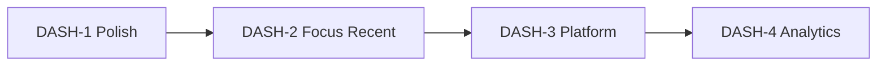

# Dashboard evolution — phased plan (layout, look, delivery)

**Status:** DASH-1–4 complete (2026-11-16). Mockup-aligned layout (2026-11-16): pill toolbar, stats strip, 3-column queues, topics+platform | dark activity. Results: [DASHBOARD_PHASED_RESULTS.md](DASHBOARD_PHASED_RESULTS.md). Code in [`components/dashboard/`](../../solve-tracker-frontend/src/components/dashboard/).  
**Design constraints:** [UI_UX_PIVOT.md §4](UI_UX_PIVOT.md) (stats only), [REQUIREMENTS.md](../REQUIREMENTS.md) **FR-05** (full-library counts, not list filters).  
**Out of scope on dashboard:** profile/sign-out, browse toolbar, full library pagination, inline create/edit forms (links/CTAs only).

**Outcome:** `/app` becomes a **scannable practice home**: headline numbers, clear next actions, light previews that deep-link into Library/Topics — without duplicating the library experience.

---

## 1. Page layout (target end state)

All content lives in the app shell main column: `mx-auto max-w-6xl px-5 py-10 sm:px-8` (match current dashboard). Vertical rhythm: `space-y-6` between **sections** on the live page.

### 1.1 Desktop (`md+`) wireframe (live `/app`, 2026-11-16)

```
┌─────────────────────────────────────────────────────────────────┐
│ H1  Your practice                    Platforms: A & B (status)   │
│     Subtitle (one line)                                          │
├─────────────────────────────────────────────────────────────────┤
│ Pill toolbar — Browse (N) · Unsolved (N) · Untagged (N)         │
│   Manage topics · Re-fetch                                       │
├─────────────────────────────────────────────────────────────────┤
│ Stats strip — Total | Solved | Unsolved | Complete               │
│   progress bar when total > 0; empty CTA when total = 0          │
├──────────────────┬──────────────────┬───────────────────────────┤
│ Pick up next     │ Recently added   │ Recently solved (≤5 each) │
│ (DASH-2 queues)  │                  │                           │
├──────────────────────────────┬──────────────────────────────────┤
│ By topic + By platform       │ Activity (dark panel)            │
│ (stacked in left column)     │ chart + weekly rows + streak     │
└──────────────────────────────┴──────────────────────────────────┘
```

### 1.2 Mobile

Same **section order** as desktop: header → toolbar → stats → **3-column queues** (stacked) → breakdown column → activity. Touch targets on pills and links ≥ comfortable tap size. No horizontal scroll for core stats.

### 1.3 Visual system (all phases)

| Element | Convention |
| --- | --- |
| Headings | `text-page` (H1), `text-section` (H2), Panel title for A |
| Numbers | `tabular-nums`, `font-medium` on key counts |
| Panels | Existing [`Panel`](../../solve-tracker-frontend/src/components/ui/Panel.tsx); one primary “Overall” panel |
| Links to work | `text-brand underline-offset-4 hover:underline` |
| Primary CTA | `ui-button` `data-variant="primary"` only for **Add problem** in B (sidebar already has CTA — avoid duplicate primary buttons in body) |
| Platform | Reuse [`PlatformMark`](../../solve-tracker-frontend/src/components/platforms/PlatformMark.tsx) where platform appears |
| Loading | [`LoadingPlaceholder`](../../solve-tracker-frontend/src/components/ui/LoadingPlaceholder.tsx) block → sectional placeholders in later phases |
| Errors | Muted status + **Try again** ([`Button`](../../solve-tracker-frontend/src/components/ui/Button.tsx) secondary), same as today |

### 1.4 Data rules (FR-05)

- **Dashboard widgets** use **`GET /progress`** for totals and per-topic rows (unchanged semantics).
- **Preview lists** (recent/stale) use **`GET /problems`** with explicit `sort` / `status` / `pageSize` — show **at most 5 rows**, no pagination UI.
- Every deep link into Library must use [`problemsBrowseHref`](../../solve-tracker-frontend/src/lib/problems/paths.ts) / [`browse-query`](../../solve-tracker-frontend/src/lib/problems/browse-query.ts) so URLs are bookmarkable.
- Copy must distinguish **full library** stats from **filtered** views (e.g. “12 unsolved in your library” linking to `?status=unsolved`).

---

## 2. Phase overview

| Phase | Name | Backend | Delivers |
| --- | --- | --- | --- |
| **DASH-1** | Baseline polish **done** | None | Layout shell, overall viz, quick links, topic rows upgraded |
| **DASH-2** | Focus & recent | None (reuse `GET /problems`) | **Done** — unsolved/untagged quick links, Focus + Recent grid |
| **DASH-3** | Platform & topic highlights | Extended `GET /progress` | **Done** — platform grid + topic sort links |
| **DASH-4** | Analytics | `GET /progress/activity` | **Done** — weekly chart/table, solve streak badge (goals deferred) |



**Dependencies:** App shell and route [`/app`](../../solve-tracker-frontend/src/routes/app/index.tsx) (UX-3/UX-4). Library filter URLs (UX-5). Platform catalog/icons (shared catalog).

---

## DASH-1 — Baseline polish (layout + overall + topics)

**Status (2026-11-16):** Done — `ProgressBar`, `DashboardPageHeader`, `DashboardStatsStrip`, `DashboardToolbar`, `DashboardTopicProgressList`; route refactored; component tests added.

**Goal:** Make the current dashboard feel intentional before adding new data calls.

### 1.1 Placement & look

| Block | Placement | Content |
| --- | --- | --- |
| H1 + summary line | Top | “Your practice” + optional subline: `{unsolved} unsolved · {percent}% complete` when `overall` ready |
| Section A | Full width, first panel | Keep `Panel` “Overall”; add **horizontal progress bar** (`role="progressbar"`, `aria-valuenow={percent}`) below counts |
| Section B | Below A | Text link row: Browse library, Manage topics, Add problem (`problemNewPath()`) |
| Section E | Below B | “By topic” — add **thin progress bar** per row; keep link to `?topicId=` |
| Empty states | Inside A / E | Unchanged copy; ensure links to add problem / topics |

### 1.2 Implementation notes

- Extract presentational pieces to `solve-tracker-frontend/src/components/dashboard/`:
  - `DashboardStatsStrip.tsx`
  - `DashboardTopicProgressList.tsx`
  - `DashboardToolbar.tsx`
- Reuse `overallPercentComplete` / `formatTopicProgress` from [`progress-display.ts`](../../solve-tracker-frontend/src/lib/problems/progress-display.ts).
- Page [`app/index.tsx`](../../solve-tracker-frontend/src/routes/app/index.tsx) orchestrates load + sections only.

### 1.3 Exit criteria

- [x] Progress bar for overall % when `total > 0`.
- [x] Each topic row shows mini bar + existing fraction string.
- [x] Quick links row visible when authenticated; no duplicate sign-out/profile.
- [x] Layout matches §1.1 on `md+` and mobile.
- [x] Loading/error behavior unchanged or improved with section skeleton.

### 1.4 Verification

```bash
cd solve-tracker-frontend && pnpm exec tsc --noEmit && pnpm test --run
```

Manual: empty library, library with topics only, library with problems.

---

## DASH-2 — Focus & recent (action-oriented previews)

**Status (2026-11-16):** Done — `dashboard-queries.ts`, `load-dashboard-previews.ts`, preview components, two-stage route load with preview retry; tests added. **Counts:** unsolved **(N)** from `GET /progress` `overall.unsolved`; untagged **(N)** from `GET /problems` `untagged=true` `meta.total` (progress has no untagged field).

**Goal:** Answer “what should I do next?” without hosting a second library.

### 2.1 Placement & look

| Block | Placement | Content |
| --- | --- | --- |
| Section B (extend) | Inline counts in links | **Unsolved (N)** → `/app/problems?status=unsolved`; **Untagged (N)** → `?untagged=true` (N from `overall` or dedicated list `meta.total` with `pageSize=1`) |
| Section C | Left column `md:grid-cols-2` | **Focus:** heading “Pick up next”; up to **5** unsolved, `sort=createdAt&order=asc` (oldest first); each row: title link → detail, `PlatformMark`, “Open library filter” footer link |
| Section D | Right column | **Recently added** (`createdAt desc`, 5) and **Recently solved** (`solvedAt desc`, `status=solved`, 5) in two sublists or tabs (“Added” / “Solved”) |
| Zero cases | Per sub-block | “Nothing here yet” + link to add problem or unsolved filter |

### 2.2 Data fetching

- After `progress` loads, parallel `GET /problems` calls (max **4**):  
  `untagged=true&pageSize=1` (meta.total), `status=unsolved&pageSize=1`, focus list, recent added, recent solved.
- Consider `solve-tracker-frontend/src/lib/dashboard/dashboard-queries.ts` with typed query presets.
- **Do not** mount browse toolbar or pagination controls.

### 2.3 Components

- `DashboardQueueGrid.tsx`, `DashboardQueueColumn.tsx`, `DashboardProblemPreviewRow.tsx`.
- Row UI: compact card rows (title, platform, topic chip, difficulty, relative time).

### 2.4 Exit criteria

- [x] C/D grid on `md+`, stacked on small screens.
- [x] All preview links open correct library filters or problem detail.
- [x] Counts: unsolved from progress; untagged from list `meta.total` (see Status above).
- [x] Failed list fetch: sectional error, dashboard overall still visible.
- [x] No regression: dashboard still no browse toolbar.

### 2.5 Verification

- Unit tests for query preset serialization (reuse `browse-query` tests where possible).
- Manual: user with 0 / few / many unsolved; verify Focus ordering.

---

## DASH-3 — Platform breakdown & topic highlights

**Status (2026-11-16):** Done — `platforms[]` on `GET /progress` (Option B: `loadProblemUrlStatuses` + `platformSlugFromUrl` bucketing); `DashboardPlatformGrid`, topic sort nav on `DashboardTopicProgressList`. Dashboard load remains **5 requests** (1 progress + 4 preview lists).

**Goal:** Surface **where** practice lives and **which topics** need attention.

### 3.1 Placement & look

| Block | Placement | Content |
| --- | --- | --- |
| Section F | Full width below topics | **By platform:** grid `grid-cols-2 sm:grid-cols-3 lg:grid-cols-4`; each cell: `PlatformMark`, solved/unsolved counts, link `?platform={slug}`; **Other** bucket for unmapped hosts (label from URL) |
| Section E (enhance) | Same section | Sort controls as **links**, not a form: “Most incomplete” (lowest %, `total > 0`), “Most remaining” (highest unsolved count), default API order |

### 3.2 Data strategy

**Option A (MVP, no backend):** Client aggregates from paginated `GET /problems` (e.g. `pageSize=100`, cap with “100+ problems — open library for full picture”). Acceptable for small libraries only.

**Option B (recommended before large libraries):** `GET /progress/platforms` or extend `GET /progress` with `platforms: { slug, solved, unsolved }[]` computed in SQL (host match via [`platform-catalog`](../../src/shared/platform-catalog.ts)).

**Implemented:** Option B — extended [`GET /progress`](../../src/modules/progress/progress.controller.ts) with `platforms[]` (no separate aggregate route).

### 3.3 Exit criteria

- [x] Platform cells use catalog slugs + Other; unknown URLs not silently dropped.
- [x] Topic highlight links: client-side sort only (no new URL params).
- [x] Performance: platform data on existing progress call; **5** total dashboard requests (progress + preview fan-out).

### 3.4 Verification

- Integration test if new endpoint; else frontend unit test for aggregation function with fixture problems.

---

## DASH-4 — Analytics

**Status (2026-11-16):** Done — `GET /progress/activity?weeks=12` (UTC week buckets, `createdAt` adds / `solvedAt` solves), solve-day streak badge on activity panel, `DashboardActivitySection` (dark panel, `DashboardActivityChart`, in-section weekly list). Goals / `PATCH /users/me/preferences` still **deferred**.

**Goal:** Longer-horizon motivation — only after DASH-1–3 stable.

### 4.1 Placement & look

| Block | Placement | Content |
| --- | --- | --- |
| Section G | Bottom full width | Weekly solves/adds chart (simple bar or table by week) |
| Optional top-right | Small badge | Streak: “N-day practice streak” |
| Optional panel | Below overall | Weekly goal progress (user-set target) |

### 4.2 Backend (new)

- `GET /progress/activity?weeks=12` — buckets by `solvedAt` / `createdAt`.
- Optional `PATCH /users/me/preferences` for goals (out of MVP).

### 4.2 Data (implemented)

- **Weeks:** Monday-based UTC buckets via SQL `date_trunc('week', …)` aligned with JS `utcWeekStart`.
- **Streak:** Distinct solve days; consecutive count only if last solve is today or yesterday (UTC).

### 4.3 Exit criteria

- [x] FR-05 still satisfied for headline numbers (activity is supplementary).
- [x] Chart accessible (weekly list in `DashboardActivitySection` + chart `aria-label` summary).
- [x] Dashboard **6** requests: progress + 4 previews + activity.

---

## 3. Cross-cutting concerns

### 3.1 Accessibility

- One `h1` per page; section `h2` ids for skip links if sections grow (`#dashboard-by-topic` already used).
- Progress bars: `aria-valuemin="0"` `aria-valuemax="100"`.
- Preview lists: `ul`/`li`, link text includes problem title (not “click here”).

### 3.2 Performance & caching

- Single `loadProgress()` on mount (today); DASH-2 adds `Promise.all` for problem fetches — cancel on route leave if needed.
- Avoid refetching on every sidebar navigation if shell keeps page mounted (Solid route behavior) — use `onSettled` + stale guard if duplicate fetches observed.

### 3.3 Documentation handoff

When each phase completes:

1. Update **Status** row in §2 table.
2. Add **`DASHBOARD_PHASED_RESULTS.md`** (mirror `PHASE_*_RESULTS.md` pattern) with manual smoke notes.
3. Tick FR-UX-04 checklist in [UI_UX_PIVOT.md](UI_UX_PIVOT.md) if dashboard acceptance expands.

### 3.4 Explicit non-goals

- Embedding library filters, topic chip toolbar, or pagination on `/app`.
- Profile fields, password, sign out on dashboard.
- Replacing Topics CRUD page with dashboard management.
- Real-time websocket updates (refresh on navigate is enough for MVP).

---

## 4. Suggested implementation order (sprints)

| Sprint | Work |
| --- | --- |
| 1 | DASH-1 components + layout refactor |
| 2 | DASH-2 query helpers + Focus/Recent + stat links |
| 3 | DASH-3 decision (A vs B) + platform grid + topic sort links |
| 4+ | DASH-4 RFC + API design before UI |

**First PR after this doc:** DASH-1 only — smallest diff, immediate visual upgrade, establishes `components/dashboard/` conventions for later phases.