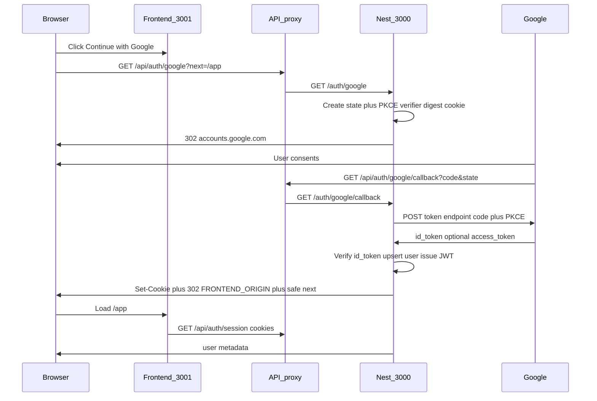
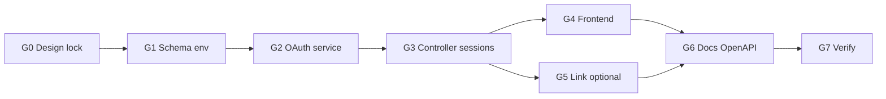

# Google OAuth sign-in — phased execution plan

**Status:** G7 complete (2026-11-18). **GOOGLE-AUTH closed** — see [GOOGLE_OAUTH_G7_RESULTS.md](GOOGLE_OAUTH_G7_RESULTS.md) and [GOOGLE_OAUTH_RESULTS.md](GOOGLE_OAUTH_RESULTS.md).  
**Codename:** `GOOGLE-AUTH` (phases **G0–G7** below).  
**Problem:** Practice is **email/password + JWT HttpOnly cookies** only ([REQUIREMENTS.md](../REQUIREMENTS.md) FR-07, [AUTH_CONVENTIONS.md](../../solve-tracker-frontend/AUTH_CONVENTIONS.md)). Users cannot sign in with Google.  
**Outcome:** **Optional Google sign-in/up** that issues the **same** Practice access/refresh cookies and `AuthSession` rows as password login, so **authorization is unchanged** (`AccessGuard`, owner scoping, refresh rotation, logout, password reset revocation). No Google tokens in the browser; no parallel bearer-auth path.

**References:** [PHASE_0_DECISIONS.md](PHASE_0_DECISIONS.md), [PHASE_3_RESULTS.md](PHASE_3_RESULTS.md) (first-party auth without Passport), [PRODUCTION.md](../PRODUCTION.md), [FRONTEND_CONVENTIONS.md](../../solve-tracker-frontend/FRONTEND_CONVENTIONS.md), [config/auth-gate.ts](../../solve-tracker-frontend/config/auth-gate.ts).

---

## 1. Scope, prerequisites, boundaries

### Prerequisites

- Phase 4 auth **complete** (`pnpm test:auth:integration`, `verify:phase-4.7` / Playwright auth suite).
- Production cookie policy documented (`__Host-*` cookies, `FRONTEND_ORIGIN`, same-origin `/api` proxy).
- Google Cloud project (user-owned); OAuth client credentials supplied via env (placeholders below).

### In scope

| Area | Deliverable |
| --- | --- |
| **Product** | “Continue with Google” on login/register; password auth retained |
| **Database** | OAuth identity storage; nullable `password_hash` for Google-only users |
| **Backend** | OAuth 2.0 authorization-code + PKCE; `id_token` validation; shared session issuance |
| **Frontend** | Safe redirect start URL; error display; **no** Google SDK secrets in bundle |
| **Security** | `state`, PKCE, `email_verified`, rate limits, no token logging, link policy |
| **Docs** | REQUIREMENTS FR-07 addendum, env examples, RESULTS file |

### Out of scope (defer unless product requests)

- Other IdPs (Apple, GitHub, Microsoft).
- Storing **Google refresh tokens** for offline API access or “sync when Google logs out”.
- Passing Google **access tokens** to the frontend.
- Replacing password auth entirely.
- Automatic unlink/re-auth when user signs out of **google.com** in another tab (see §6).
- Nest **Passport** strategies as the core design (see §2.3).

---

## 2. Architecture and technology choices

### 2.1 Session model (unchanged — this is the integration contract)

Google sign-in **must not** introduce a second session type.

| Layer | After Google callback success |
| --- | --- |
| **PostgreSQL** | New row in `auth_sessions` (same as `AuthService.login`) |
| **JWT** | `TokenService.issue` → access + refresh (same iss/aud/purpose rules) |
| **Cookies** | `AuthCookies.set` → HttpOnly access + refresh |
| **API authorization** | `AccessGuard` + session revocation checks — **no code path changes** |
| **Frontend** | `AuthProvider` bootstrap / `GET /auth/session` — **no Google-specific client state** |

Password users who also use Google use **one user id**, one email, **one session family** at a time per login.

### 2.2 OAuth flow (recommended): backend authorization-code + PKCE



**Why backend callback:** Client secret stays on Nest; aligns with existing cookie issuance; matches [AUTH_CONVENTIONS.md](../../solve-tracker-frontend/AUTH_CONVENTIONS.md) (no JWT strings in JS).

**CSRF:** OAuth start is **GET** — do **not** rely on `X-Requested-With`. Use **cryptographic `state`** (+ optional short-lived **HttpOnly PKCE/state cookie** bound to callback). Reject callback when `state` missing or mismatch.

### 2.3 Passport vs first-party (decision)

| Option | Verdict |
| --- | --- |
| **`passport` + `passport-google-oauth20`** | Familiar, but Phase 3 **explicitly avoided Passport** for the rotating refresh + PostgreSQL session contract ([PHASE_3_RESULTS.md](PHASE_3_RESULTS.md)). Strategies often push session middleware assumptions that fight HttpOnly JWT cookies and custom rotation. |
| **Recommended: thin `GoogleOAuthService`** | `fetch` to Google token endpoint + `jose` `jwtVerify` on `id_token` (already in tree). Single module; full control over cookies, limits, logging, tests. |
| **Compromise** | Use Passport **only** inside an isolated adapter if the team insists, but still call existing `AuthService.establishOAuthSession()` — **no** `req.login()` / server-side Passport sessions. |

**G0 locked:** **no new Passport dependency**; thin `GoogleOAuthService` ([GOOGLE_OAUTH_A0_RESULTS.md](GOOGLE_OAUTH_A0_RESULTS.md)).

### 2.4 Linking policy (security-default — lock in G0)

| Scenario | Policy (recommended) |
| --- | --- |
| **Google `sub` already linked** | Issue session for that user (login). |
| **New Google user** (`email_verified`, no local user) | Create user **without password**; link identity row. |
| **Local user exists** (same normalized email), **no Google link yet** | **G0: auto-link** when `email_verified` — upsert identity, establish session (see RESULTS for risk mitigations). |
| **Google email not verified** | Reject; redirect login error. |
| **Email differs from Google `sub` collision** | Impossible per provider; handle DB unique violations only. |

Stricter alternative (documented, not selected): require password login before linking when local user exists with same email.

**G0 locked (2026-11-18):** **auto-link on verified email** — when local user exists (same normalized email), no Google link yet, and `email_verified === true`, upsert identity and establish session in one step. See [GOOGLE_OAUTH_A0_RESULTS.md](GOOGLE_OAUTH_A0_RESULTS.md).

---

## 3. Database design

### 3.1 Tables (target state)

**`users` (alter)**

| Column | Change |
| --- | --- |
| `password_hash` | **`NULL` allowed** — Google-only accounts have no password |
| Other columns | Unchanged (`name`, `email` unique, profile fields) |

**`auth_provider_identities` (new)** — prefer separate table over stuffing `google_sub` on `users` (future providers, audit).

| Column | Type | Notes |
| --- | --- | --- |
| `id` | `uuid` PK | |
| `user_id` | `uuid` FK → `users.id` ON DELETE CASCADE | |
| `provider` | `text` | Check: `'google'` initially |
| `provider_subject` | `text` | Google `sub`; **unique (provider, provider_subject)** |
| `provider_email` | `text` | Last seen email from token (not authority for login) |
| `linked_at` | `timestamptz` | |
| `updated_at` | `timestamptz` | |

**Indexes**

- `UNIQUE (provider, provider_subject)`
- `INDEX (user_id)`

**Do not store** Google access/refresh tokens in PostgreSQL for MVP (reduces leak blast radius).

### 3.2 Migration rules

- Backfill: existing users get **no** identity rows until they use Google or link.
- `password_hash NOT NULL` → nullable: migration + ensure password login still rejects null hash with `INVALID_CREDENTIALS` (same generic message).

### 3.3 Entity diagram

```mermaid
erDiagram
  users ||--o{ auth_provider_identities : has
  users ||--o{ auth_sessions : has
  users {
    uuid id PK
    text email UK
    text password_hash nullable
    text name
  }
  auth_provider_identities {
    uuid id PK
    uuid user_id FK
    text provider
    text provider_subject UK
  }
  auth_sessions {
    uuid id PK
    uuid user_id FK
    text refresh_digest
  }
```

---

## 4. Backend API surface

| Method | Path | Auth | Behavior |
| --- | --- | --- | --- |
| `GET` | `/auth/google` | Public | Rate-limited; validate `next` against allowlist; set state/PKCE cookies; 302 to Google |
| `GET` | `/auth/google/callback` | Public | Rate-limited; verify `state` + PKCE; exchange code; upsert/link user; `AuthCookies.set`; 302 to safe `next` or `/app` |
| `POST` | `/auth/login` | Public | Unchanged |
| `POST` | `/auth/register` | Public | Unchanged |
| `GET` | `/auth/session` | Access JWT | Unchanged |
| Optional G5 | `POST` | `/auth/google/link` | Access JWT + password step-up | Link Google to current user |
| Optional G5 | `DELETE` | `/auth/google/link` | Access JWT | Unlink (block if Google-only and no password) |

OpenAPI: document query params (`next`), redirect responses (`302`), and **no JSON body** on start/callback. Run `api:export` + frontend `api:generate` in G6.

### 4.1 Environment variables (placeholders — add to Zod + `.env.example`)

```bash
# Feature gate (disable routes when false)
GOOGLE_OAUTH_ENABLED=false

# Google Cloud OAuth 2.0 Web client
GOOGLE_OAUTH_CLIENT_ID=placeholder.apps.googleusercontent.com
GOOGLE_OAUTH_CLIENT_SECRET=placeholder_replace_in_secret_store

# Must match Google Console "Authorized redirect URIs" exactly.
# Typical local: http://localhost:3001/api/auth/google/callback (browser hits proxy)
# Typical prod: https://your-public-origin.example/api/auth/google/callback
GOOGLE_OAUTH_REDIRECT_URI=http://localhost:3001/api/auth/google/callback

# Space-separated scopes; default openid email profile
GOOGLE_OAUTH_SCOPES=openid email profile

# Optional: separate consent prompt control (openid prompt=consent|select_account)
GOOGLE_OAUTH_PROMPT=select_account

# Short TTL for OAuth state cookie (seconds)
GOOGLE_OAUTH_STATE_TTL_SECONDS=600

# When GOOGLE_OAUTH_ENABLED=false, hide UI via same flag mirrored in frontend build-time or runtime config
```

**Validation (G1):**

- If `GOOGLE_OAUTH_ENABLED=true`, require client id, secret, redirect URI.
- `GOOGLE_OAUTH_REDIRECT_URI` origin must align with `FRONTEND_ORIGIN` + `/api` proxy path (document in PRODUCTION).
- Production: `AUTH_COOKIE_SECURE=true`; redirect URI must be `https`.

**Secrets:** Never log client secret, authorization codes, `id_token`, or raw JWTs.

---

## 5. Frontend behavior

### 5.1 UI

- Login + register: **link** (anchor or `window.location`) to  
  `/api/auth/google?next=${encodeURIComponent(safeNext)}`  
  where `safeNext` uses existing [`safeReturnPath`](../../solve-tracker-frontend/src/lib/auth/forms.ts).
- When `GOOGLE_OAUTH_ENABLED=false`, hide control (build-time env or lightweight `GET /auth/config` public flags — choose in G4).

### 5.2 Routes and SSR

- **No** Solid route for `/auth/google/callback` — browser never renders SPA on callback; Nest redirects to app route.
- [`auth-gate.ts`](../../solve-tracker-frontend/config/auth-gate.ts): ensure `/api/auth/google` paths proxy only; do **not** treat callback as app shell SSR.
- Login/register remain public; authenticated users hitting OAuth start may **redirect to `/app`** if already session-valid (optional optimization in G4).

### 5.3 Errors

- Callback failures → `302` to `/login?oauth_error=...` (enum codes, no stack traces).
- Map codes to user-safe copy on login page.

### 5.4 Authorization after sign-in

- Identical to password login: `productClient` + `AccessGuard` on `/problems`, `/topics`, etc.
- Refresh coordinator unchanged ([AUTH_CONVENTIONS.md](../../solve-tracker-frontend/AUTH_CONVENTIONS.md)).

---

## 6. Google account logout vs Practice session (critical)

Two **independent** sessions exist:

| Session | Where it lives | What Practice controls |
| --- | --- | --- |
| **Practice session** | HttpOnly JWT cookies + `auth_sessions` | Logout button, password reset, refresh rotation, expiry |
| **Google account session** | Google cookies on `accounts.google.com` | **Not** controlled by Practice (MVP does not store Google tokens) |

### 6.1 User signs out of **Google** in the browser (only Google)

- **Practice app remains signed in** until access JWT expires, refresh fails, or user clicks **Sign out** in Practice.
- Next click **Continue with Google** may skip Google login UI (still logged into Google) or prompt account picker — Google UX, not Practice.
- **We do not** receive a webhook when user logs out of Google (unless later: unused token introspection — out of scope).

### 6.2 User signs out of **Practice**

- `POST /auth/logout` revokes refresh session, clears cookies (unchanged).
- **Google account may still be signed in** — next Google button click may one-click consent. Acceptable; optional `prompt=select_account` on each start (configurable via `GOOGLE_OAUTH_PROMPT`).

### 6.3 User revokes Practice app in Google Account settings

- When **RISC is disabled** (default): existing Practice cookies **still work** until TTL, Practice logout, or password reset — we do not store Google refresh tokens to poll Google. **Next** OAuth attempt may show re-consent.
- When **RISC is enabled** and the stream is registered: Google may send `sessions-revoked` / `tokens-revoked` and the backend revokes all Practice sessions for the linked user ([GOOGLE_RISC_RESULTS.md](GOOGLE_RISC_RESULTS.md)).

### 6.4 User deleted on Google / email change at Google

- Old `provider_subject` (`sub`) is stable for the life of the Google account; email changes update `provider_email` on next login.
- If Google disables the account, next OAuth fails at token exchange — show generic login error.

**Product copy (G6 / RISC R6):** See frontend `GOOGLE_PRACTICE_LOGOUT_NOTE` in `oauth-error-copy.ts` (casual Google logout + optional Cross-Account Protection sentence).

### 6.5 Optional RISC hardening (GOOGLE-RISC)

- When `GOOGLE_RISC_ENABLED=true` and the Google stream is registered, selected **security events** revoke all Practice sessions for users linked via `auth_provider_identities` (`sub`).
- Does **not** close the gap for casual Google sign-out in one tab when Google sends **no** event.
- Rollout, limitations, and ops: [GOOGLE_RISC_RESULTS.md](GOOGLE_RISC_RESULTS.md), [GOOGLE_RISC_STREAM_SETUP.md](GOOGLE_RISC_STREAM_SETUP.md).

---

## 7. Security requirements (non-negotiable)

| Control | Requirement |
| --- | --- |
| **PKCE** | `S256` code challenge on authorize URL; verify `code_verifier` on callback |
| **state** | Cryptographic random; bind to user agent via HttpOnly short-lived cookie or server-side store; constant-time compare |
| **id_token** | Verify `iss`, `aud` (client id), `exp`, `sub`; require `email_verified === true` |
| **Redirect** | `next` allowlist same as `safeReturnPath` rules; never open redirect |
| **Rate limit** | Extend `AuthLimiter` for `/auth/google` and `/auth/google/callback` (per IP + optional per email) |
| **Secrets** | Code single-use; reject replayed codes |
| **Logging** | Log outcome + user id on success; never log codes/tokens |
| **CSRF on API** | OAuth routes exempt from `X-Requested-With` but **not** from origin checks where applicable |
| **Production** | HTTPS, `__Host-` cookies, `FRONTEND_ORIGIN` match |
| **Account linking** | Per §2.4 — no silent merge without G0-approved policy |
| **Dependency** | Pin Google token issuer JWKS fetch with cache + timeout; prefer `jose` over ad-hoc JWT decode |

---

## 8. Phased execution

### G0 — Design lock & requirements

| Deliverable | Detail |
| --- | --- |
| Decisions | Passport vs thin service (**default: thin**); linking policy §2.4; Google-only users allowed |
| Docs | Amend REQUIREMENTS FR-07; draft [GOOGLE_OAUTH_A0_RESULTS.md](GOOGLE_OAUTH_A0_RESULTS.md) |
| Google Console checklist | Origins, redirect URI, OAuth consent screen |

**Exit:** Signed decision table; env placeholders in plan (§4.1).

---

### G1 — Schema & configuration

| Deliverable | Detail |
| --- | --- |
| Migration | `auth_provider_identities`; `users.password_hash` nullable |
| Zod | `authEnvironmentSchema` + optional block when `GOOGLE_OAUTH_ENABLED` |
| `.env.example` | Placeholder vars §4.1 |
| Repository | CRUD for identities; lookup by `(provider, sub)` and by `user_id` |

**Verify:** `pnpm db:check`; unit tests on repository.

---

### G2 — Google OAuth service (core)

| Deliverable | Detail |
| --- | --- |
| `GoogleOAuthService` | Build authorize URL (PKCE); exchange code; verify `id_token` |
| `OAuthStateService` | Issue/validate state + PKCE verifier cookie |
| Tests | Mock Google token endpoint + JWKS; bad `state`, expired token, unverified email |

**Verify:** `pnpm test` (Vitest) in backend.

---

### G3 — Auth controller integration & session issuance

| Deliverable | Detail |
| --- | --- |
| Routes | `GET /auth/google`, `GET /auth/google/callback` |
| `AuthService.establishOAuthSession(userId)` | Reuse login session insert + `TokenService` + return tokens |
| Linking rules | Implement G0 policy |
| Disable path | `GOOGLE_OAUTH_ENABLED=false` → `404` or `503` on OAuth routes |

**Verify:** `pnpm test:auth:integration`; manual curl redirect chain (mock Google).

---

### G4 — Frontend

| Deliverable | Detail |
| --- | --- |
| Login/register | Google button → `/api/auth/google?next=` |
| Error handling | `oauth_error` query params |
| Feature flag | Hide when disabled |
| AUTH_CONVENTIONS | Add OAuth section (server redirect only) |

**Verify:** `pnpm --dir solve-tracker-frontend check`; manual dev flow.

---

### G5 — Account linking (optional but recommended for §2.4 strict policy)

| Deliverable | Detail |
| --- | --- |
| Profile UI | “Link Google account” → same OAuth start with `?mode=link` + authenticated cookie |
| Backend | `mode=link` requires valid access JWT; attach identity to current user |
| Unlink | Only if password set or another provider exists |

**Verify:** Integration tests for link/unlink edge cases.

---

### G6 — OpenAPI, ops, documentation

| Deliverable | Detail |
| --- | --- |
| OpenAPI | Document OAuth redirects |
| `api:export` / `api:generate` | Frontend types if needed |
| [PRODUCTION.md](../PRODUCTION.md) | Redirect URI + Google Console |
| [GOOGLE_OAUTH_RESULTS.md](GOOGLE_OAUTH_RESULTS.md) | Summary + manual checklist |
| Privacy | Note Google as identity processor |

**Verify:** `pnpm verify:platform-api` unaffected; `pnpm api:check`.

---

### G7 — Regression gate

| Deliverable | Detail |
| --- | --- |
| Script | Optional `verify:google-oauth.mjs` — env schema, routes registered, enabled flag off in CI by default |
| Full suite | `pnpm test:auth:integration`, frontend `pnpm check`, `verify:phase-8` |

**Exit:** RESULTS signed; feature enabled only when env complete in target environment.

---

## 9. Phase dependency graph



---

## 10. Manual acceptance checklist (post-G7)

- [ ] `GOOGLE_OAUTH_ENABLED=true` with real credentials (staging only).
- [ ] New user: Google → lands `/app`, session probe OK, library CRUD works.
- [ ] Existing password user: policy per G0 (link or block) behaves as documented.
- [ ] Logout Practice → protected routes redirect login; cookies cleared.
- [ ] Logout Google only (accounts.google.com) → **Practice still works** until Practice logout (§6).
- [ ] Password reset revokes Google-established sessions too.
- [ ] Invalid/forged `state` on callback rejected.
- [ ] Rate limit triggers on repeated OAuth starts.
- [ ] Production redirect URI and `FRONTEND_ORIGIN` match Google Console.

---

## 11. Rollback

- Set `GOOGLE_OAUTH_ENABLED=false` — hide UI, return 404 on OAuth routes.
- Password auth unaffected; identity rows remain harmless.
- Revert nullable `password_hash` only if no Google-only users exist (check before down migration).

---

## 12. Summary

| Item | Decision |
| --- | --- |
| Integration style | **Backend OAuth code + PKCE**; same JWT cookies as password login |
| Passport | **Not recommended**; use thin `GoogleOAuthService` + existing `AuthService` |
| DB | **`auth_provider_identities`** + nullable `password_hash` |
| Authorization | **Unchanged** — same `AccessGuard` and session revocation |
| Google logout in browser | **Does not** end Practice session (MVP) |
| Account linking | **Auto-link** on `email_verified` + normalized email match ([GOOGLE_OAUTH_A0_RESULTS.md](GOOGLE_OAUTH_A0_RESULTS.md)) |
| Env | Placeholders §4.1; user supplies real values later |

**Start with:** **G1** migration + env schema (G0 complete).