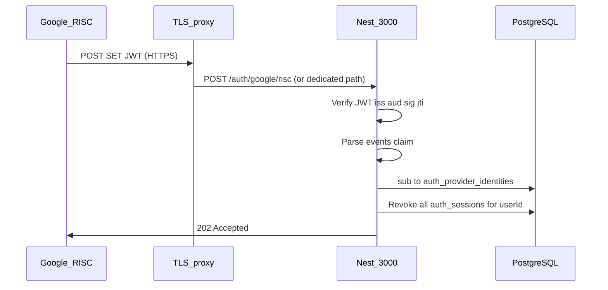
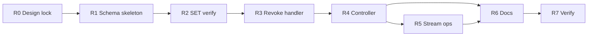

# Google Cross-Account Protection (RISC) — phased execution plan

**Status:** R6 complete (2026-11-18). **Rollup:** [GOOGLE_RISC_RESULTS.md](GOOGLE_RISC_RESULTS.md). **Design lock:** [GOOGLE_RISC_A0_RESULTS.md](GOOGLE_RISC_A0_RESULTS.md). **R1:** [GOOGLE_RISC_R1_RESULTS.md](GOOGLE_RISC_R1_RESULTS.md). **R2:** [GOOGLE_RISC_R2_RESULTS.md](GOOGLE_RISC_R2_RESULTS.md). **R3:** [GOOGLE_RISC_R3_RESULTS.md](GOOGLE_RISC_R3_RESULTS.md). **R4:** [GOOGLE_RISC_R4_RESULTS.md](GOOGLE_RISC_R4_RESULTS.md). **R5:** [GOOGLE_RISC_R5_RESULTS.md](GOOGLE_RISC_R5_RESULTS.md). **R6:** [GOOGLE_RISC_RESULTS.md](GOOGLE_RISC_RESULTS.md). Staging smoke evidence pending in R5 results.  
**Codename:** `GOOGLE-RISC` (phases **R0–R7** below).  
**Problem:** Practice and Google sessions are **independent** ([GOOGLE_OAUTH_PHASED_PLAN.md](GOOGLE_OAUTH_PHASED_PLAN.md) §6). When a user revokes the app, signs out of **all** Google sessions, or Google disables the account, Practice `auth_sessions` and HttpOnly cookies can remain valid until TTL, logout, or password reset.  
**Outcome:** Subscribe to [Google Cross-Account Protection (RISC)](https://developers.google.com/identity/protocols/risc) so **selected security events** trigger **server-side revocation of all Practice sessions** for the linked user. **No** Google tokens stored; **no** per-request Google calls; **authorization unchanged** (`AccessGuard` + existing session checks). Optional product copy update: partial vs total Google logout (see §6).

**References:** [GOOGLE_RISC_A0_RESULTS.md](GOOGLE_RISC_A0_RESULTS.md), [GOOGLE_OAUTH_RESULTS.md](GOOGLE_OAUTH_RESULTS.md), [GOOGLE_OAUTH_A0_RESULTS.md](GOOGLE_OAUTH_A0_RESULTS.md), [AUTH_CONVENTIONS.md](../../solve-tracker-frontend/AUTH_CONVENTIONS.md), [PHASE_0_DECISIONS.md](PHASE_0_DECISIONS.md) (immediate revocation), [PRODUCTION.md](../PRODUCTION.md), [RISC Terms of Service](https://developers.google.com/identity/protocols/risc) (use signals only for security / session management).

---

## 1. Scope, prerequisites, boundaries

### Prerequisites

- **GOOGLE-AUTH complete** (G0–G7): `auth_provider_identities`, `GoogleOAuthService`, `GOOGLE_OAUTH_ENABLED` production path.
- Same **Google Cloud project** and OAuth client as Google sign-in; consent screen configured.
- **Production (or staging) HTTPS** origin reachable by Google’s delivery infrastructure (not `localhost` unless tunneled for a one-off test).
- Password reset / change-password already **revoke all `auth_sessions` for `userId`** — RISC must call the **same** semantics (see R3).

### In scope

| Area | Deliverable |
| --- | --- |
| **Receiver** | `POST` HTTPS endpoint on Nest; validate Security Event Tokens (SETs); respond **202 Accepted** |
| **Events** | Handle Google-documented types that require ending app sessions (§4) |
| **Identity map** | Google `sub` → `auth_provider_identities` → `users.id` → revoke all active sessions |
| **Security** | JWT signature + claims validation; replay/idempotency for `jti`; rate limit; no SET bodies in product logs |
| **Registration** | Stream configuration via `risc.googleapis.com` (documented ops runbook) |
| **Feature gate** | `GOOGLE_RISC_ENABLED=false` by default; independent of UI |
| **Verification** | Unit tests (fixtures), optional integration with mocked SETs; `verify:google-risc` script |
| **Docs** | `GOOGLE_RISC_RESULTS.md`, PRODUCTION section, cross-link from GOOGLE OAuth docs |

### Out of scope (defer unless product requests)

- Detecting **casual** “Sign out” on Google in one browser tab with **no** RISC event (Google may not send one).
- Storing Google **refresh tokens** for `token-revoked` prefix/hash matching (we do not issue offline access today).
- **Front-channel** or **OIDC session iframe** checks.
- **RP-initiated** “Sign out of Google too” on Practice logout (separate small UX task; complementary, not RISC).
- RISC **sender** events from Practice → Google (only needed for Google Account Linking-style bidirectional token revocation).
- **Google Workspace** users (Google documents CAP as consumer-focused; no commitment to Workspace signals).

### Non-goals (architecture)

- No change to cookie names, JWT purposes, or `AccessGuard` rules.
- No Google tokens in browser or API JSON.
- No Redis, queues, or workers required for MVP RISC (synchronous revoke in request handler is acceptable if DB work stays bounded; async job optional if p95 latency threatens 202 SLA).

---

## 2. Policy and event semantics

### 2.1 What RISC does and does not do

| User action | Typical RISC signal | Practice response (target) |
| --- | --- | --- |
| Removes app access in Google Account | `tokens-revoked` / `token-revoked` | Revoke **all** sessions for user linked to Google `sub` |
| Signs out of **all** Google sessions / security revocation | `sessions-revoked` | Revoke **all** sessions for that `sub` |
| Account disabled (hijacking, bulk, etc.) | `account-disabled` | **Hybrid** (R0): revoke all sessions for `hijacking`, `bulk-account`, or missing `reason`; structured ops log — [GOOGLE_RISC_A0_RESULTS.md](GOOGLE_RISC_A0_RESULTS.md) |
| Signs out of Google in **one** profile only | Often **no** event | Practice may remain signed in until user clicks Practice **Sign out** or session expires |
| Practice **Sign out** | N/A (we initiate) | Unchanged: `POST /auth/logout` |

**Product copy:** After RISC ships, soften `GOOGLE_PRACTICE_LOGOUT_NOTE` to distinguish “local Google sign-out” vs “Google revoked access / all sessions” (G6-style copy in frontend `oauth-error-copy.ts`).

### 2.2 Session contract (unchanged)

RISC is **server-side revocation only**. Browsers keep HttpOnly cookies until the next request fails `AccessGuard` / refresh (`AUTH_SESSION_INVALID`). Frontend auth coordinator already handles terminal session invalidation ([AUTH_CONVENTIONS.md](../../solve-tracker-frontend/AUTH_CONVENTIONS.md)); **no RISC-specific client state** required. Optional later: `BroadcastChannel` / `logout` hint if other tabs stay open — not required for MVP if access TTL is short.

### 2.3 Shared revocation helper (implementation contract)

Extract or add **`AuthService.revokeAllSessionsForUser(userId: string, reason: string)`** (transactional `UPDATE auth_sessions SET revoked_at` where user id matches), reused by:

- Password reset (existing),
- Change password (existing),
- RISC handlers (new).

RISC must **not** duplicate ad-hoc SQL in a new module.

### 2.4 Password-only users

Events reference **Google account** subjects. Users **without** a linked Google identity are unaffected. Users with **both** password and Google remain password-capable after revocation **unless** `account-disabled` policy says otherwise (document: sessions end; password login may still work if account not disabled on Practice side).

---

## 3. Architecture

### 3.1 Delivery flow

**Path (R0 locked):** **`POST /auth/google/risc`** via dedicated **`GoogleRiscController`** (not `AuthController` — avoids `AuthSecurityGuard` CSRF). Delivery URL: `{FRONTEND_ORIGIN}/api/auth/google/risc`.

**Authentication:** Endpoint is **unauthenticated** (Google is the caller). Protect via **SET validation** only; IP allowlists **not** relied upon. **Do not** require browser CSRF on this POST.

### 3.2 Token validation (thin `GoogleRiscService`)

Mirror `GoogleOAuthService` / `GoogleJwksCache` patterns:

| Step | Requirement |
| --- | --- |
| Parse | Accept `Content-Type` per Google docs (JWT string in body) |
| Verify signature | `jose` `jwtVerify` against Google RISC JWKS (cache keys; separate URL from `id_token` if different — load from [RISC configuration](https://accounts.google.com/.well-known/risc-configuration)) |
| Validate claims | `iss`, `aud` (Practice receiver id / OAuth client id per Google registration), `iat`, `jti`, `events` object |
| Idempotency | Persist processed `jti` in **`risc_event_receipts`** (R0) — safe replays return 202 without double work |
| Logging | Log `event_type`, `sub`, `userId`, `jti`, outcome — **never** log full SET |

### 3.3 Event handlers (initial subscribe list)

Register at minimum:

| Event type | Handler |
| --- | --- |
| `https://schemas.openid.net/secevent/risc/event-type/sessions-revoked` | Resolve `sub` → user → `revokeAllSessionsForUser` |
| `https://schemas.openid.net/secevent/oauth/event-type/tokens-revoked` | Same (Google: end Google Sign-in sessions) |
| `https://schemas.openid.net/secevent/risc/event-type/account-disabled` | **Hybrid (R0):** revoke for `hijacking`, `bulk-account`, or missing `reason`; ops log severity varies — see [GOOGLE_RISC_A0_RESULTS.md](GOOGLE_RISC_A0_RESULTS.md) |

**Defer** granular `token-revoked` with `oauth_token` subject until we store refresh tokens (out of scope).

Subject identifier: `subject_type: "iss-sub"` → `subject.sub` per Google SET examples; reject unknown `subject_type` with 202 + warn log (avoid Google retry storms on 500).

### 3.4 Stream registration (operations)

One-time / per-environment task (document in PRODUCTION, not committed secrets):

1. Enable **RISC API** in Google Cloud project.
2. Call `https://risc.googleapis.com/v1beta/stream:update` with delivery URL `https://<public-api-host>/api/auth/google/risc` (match reverse proxy path).
3. Set `events_requested` to the types in §3.3.
4. Run Google’s **verification** handshake (endpoint must echo validation token when configuring).
5. Record **receiver id** / audience expectations for JWT `aud` checks.

Staging and production require **separate** streams or delivery URLs.

---

## 4. Environment and configuration

### 4.1 Proposed variables (`environment.ts` + `.env.example`)

| Variable | Required when | Purpose |
| --- | --- | --- |
| `GOOGLE_RISC_ENABLED` | always | `true` \| `false` gate |
| `GOOGLE_OAUTH_CLIENT_ID` | RISC on | Same client as OAuth; often JWT `aud` |
| `GOOGLE_RISC_AUDIENCE` | optional | Override `aud` if Google assigns distinct receiver id |
| `GOOGLE_RISC_JWKS_URL` | optional | Default from well-known RISC configuration |
| `GOOGLE_RISC_EVENT_TTL_SECONDS` | optional | Retention for `jti` receipt rows (compliance + idempotency) |

**Validation rule:** When `GOOGLE_RISC_ENABLED=true`, require `GOOGLE_OAUTH_ENABLED=true` and configured `GOOGLE_OAUTH_CLIENT_ID`.

### 4.2 Local development

| Mode | Approach |
| --- | --- |
| **Default** | `GOOGLE_RISC_ENABLED=false` — no public endpoint required |
| **Manual E2E** | ngrok/cloudflared → staging stream pointing at tunnel **temporarily** |
| **Automated tests** | Sign SET fixtures with test keys **or** mock `GoogleRiscService` in unit tests; no dependency on Google egress in CI |

---

## 5. Phased execution

### R0 — Design lock

**Status:** complete (2026-11-18). **Results:** [GOOGLE_RISC_A0_RESULTS.md](GOOGLE_RISC_A0_RESULTS.md).

| Deliverable | Detail |
| --- | --- |
| Lock path | `POST /auth/google/risc`; `GoogleRiscController` without `AuthSecurityGuard` |
| Lock events | §3.3 subscribe list + hybrid `account-disabled` |
| Lock revocation | `AuthService.revokeAllSessionsForUser` shared helper |
| Lock idempotency | **`risc_event_receipts`**; purge-on-insert retention |
| HTTP policy | 202 on success/idempotent noop; see A0 status table |

**Exit:** Results file signed; this plan’s §2–§4 match results.

---

### R1 — Schema and module skeleton

**Status:** complete (2026-11-18). **Results:** [GOOGLE_RISC_R1_RESULTS.md](GOOGLE_RISC_R1_RESULTS.md).

| Deliverable | Detail |
| --- | --- |
| Migration | **`risc_event_receipts`** — `drizzle/20261118092718_stiff_scarlet_witch/` |
| Module | `GoogleRiscModule` in `AuthModule`; `GoogleRiscController` without CSRF guard |
| Gate | 404 when disabled; **501** skeleton when enabled (until R4) |
| Env | `googleRiscEnvironmentSchema` + `.env.example` |

**Verify:** `pnpm db:check`, `pnpm test`, `test:risc-receipts:integration` on `*_test` DB.

---

### R2 — SET validation service

**Status:** complete (2026-11-18). **Results:** [GOOGLE_RISC_R2_RESULTS.md](GOOGLE_RISC_R2_RESULTS.md).

| Deliverable | Detail |
| --- | --- |
| `verifySet` | `GoogleRiscJwksCache` + Zod payload + typed errors |
| Constants | `GOOGLE_RISC_SUBSCRIBED_EVENT_TYPES`, issuers, clock tolerance |
| Controller | Still **501** until R4 |

**Verify:** `pnpm test` — SET fixtures (valid / wrong aud / bad sig / malformed / expired exp).

---

### R3 — Event handling and session revocation

**Status:** complete (2026-11-18). **Results:** [GOOGLE_RISC_R3_RESULTS.md](GOOGLE_RISC_R3_RESULTS.md).

| Deliverable | Detail |
| --- | --- |
| `AuthService.revokeAllSessionsForUser` | Refactor from reset/change-password paths |
| `GoogleRiscService.handleVerifiedEvent` | `sub` → `AuthProviderIdentityRepository.findByProviderSubject('google', sub)` → revoke |
| No user | Receipt + `orphan` outcome (HTTP **202** in R4) |
| `account-disabled` | Hybrid ops logging per §3.3 |

**Verify:** `pnpm test`, `pnpm test:auth:integration`, `test:google-risc-handle:integration` on `*_test` DB.

---

### R4 — HTTP controller and hardening

**Status:** complete (2026-11-18). **Results:** [GOOGLE_RISC_R4_RESULTS.md](GOOGLE_RISC_R4_RESULTS.md).

| Deliverable | Detail |
| --- | --- |
| Controller | Raw JWT body; **202** on success |
| Rate limit | `GoogleRiscLimiter` — per IP + global |
| Body size cap | **8KB** text parser on `/auth/google/risc` |
| Swagger | `Internal webhooks` tag |

**Verify:** `pnpm test`, `test:google-risc-http:integration`, `pnpm api:check`.

---

### R5 — Stream registration runbook and staging smoke

**Status:** runbook and tooling complete (2026-11-18). **Runbook:** [GOOGLE_RISC_STREAM_SETUP.md](GOOGLE_RISC_STREAM_SETUP.md). **Results:** [GOOGLE_RISC_R5_RESULTS.md](GOOGLE_RISC_R5_RESULTS.md) (staging evidence: operator).

| Deliverable | Detail |
| --- | --- |
| Runbook | `GOOGLE_RISC_STREAM_SETUP.md` + [PRODUCTION.md](../PRODUCTION.md) § RISC |
| Preflight | `pnpm preflight:google-risc` |
| Local SET helper | `pnpm sign:test-risc-set` |
| Staging | Register stream; `stream:verify` + one real SET (manual) |

**Exit:** Staging table in `GOOGLE_RISC_R5_RESULTS.md` filled with redacted evidence.

---

### R6 — Documentation and product copy

**Status:** complete (2026-11-18). **Rollup:** [GOOGLE_RISC_RESULTS.md](GOOGLE_RISC_RESULTS.md).

| Deliverable | Detail |
| --- | --- |
| Rollup + limitations §6 | `GOOGLE_RISC_RESULTS.md` |
| OAuth / requirements / conventions | Cross-links + `GOOGLE_PRACTICE_LOGOUT_NOTE` (expanded) |

**Verify:** `pnpm test` (backend + frontend); `pnpm api:check`.

---

### R7 — Verify script and regression gate

| Deliverable | Detail |
| --- | --- |
| `scripts/verify-google-risc.mjs` | Env schema, route registered, module import, flag off in default CI |
| `scripts/verify-google-risc-exit.mjs` | Runs unit/integration tests tagged `risc` |
| `package.json` | `verify:google-risc`, optional hook in `verify:phase-9` or phase-8 umbrella (document only) |

**Exit:** `pnpm verify:google-risc` green in CI without public URL; staging smoke optional manual gate.

---

## 6. Phase dependency graph

R5 can run in parallel with late R4 once endpoint is on staging TLS.

---

## 7. Manual acceptance checklist (post-R7)

- [ ] Staging stream registered; Google verification handshake succeeded.
- [ ] Synthetic or real `sessions-revoked` → all `auth_sessions` for linked user have `revoked_at`.
- [ ] Next `GET /auth/session` / protected API → `AUTH_SESSION_INVALID` (or refresh failure).
- [ ] User with **no** Practice account but Google event → 202, no 500.
- [ ] Duplicate `jti` redelivered → 202, single revoke transaction.
- [ ] `GOOGLE_RISC_ENABLED=false` → 404 on webhook; OAuth login unaffected.
- [ ] Password-only user → no RISC traffic affects them.
- [ ] Logs contain no full SET; compliant with RISC Terms use case.
- [ ] **Casual** Google tab sign-out (if no event) — document observed behavior; Practice may still work.

---

## 8. Rollback

| Action | Effect |
| --- | --- |
| `GOOGLE_RISC_ENABLED=false` | Webhook 404; sessions only end via normal logout/reset/TTL |
| Google `stream:update` status `disabled` | Stop delivery; Practice code can remain |
| Drop `risc_event_receipts` | Only after disabling feature (migration down optional) |

---

## 9. Risks and mitigations

| Risk | Mitigation |
| --- | --- |
| Misconfigured `aud` → rejected events | Staging smoke in R5; alert on error rate |
| Multi-replica duplicate `jti` handling | DB unique on `jti` |
| Slow revoke → Google timeout | Keep handler fast; 202 after commit |
| Over-broad `account-disabled` | Policy table in R0/R3; default conservative revoke |
| Workspace users | Document no signal; no false expectation |
| Legal / ToS | Security-only use of SET data; retention limit on receipts |

---

## 10. Summary

| Item | Decision |
| --- | --- |
| Integration style | **Webhook receiver** on Nest; **async from Google’s perspective** |
| Session impact | **`revokeAllSessionsForUser`** — same as password reset |
| Google tokens | **Still not stored**; events keyed by **`sub`** |
| Authorization | **Unchanged** — revocation enforced on next request |
| Casual Google logout | **Still not guaranteed** without RISC event |
| Default | **`GOOGLE_RISC_ENABLED=false`** until staging stream proven |
| Passport / workers | **Not used** |

---

## 11. Relationship to GOOGLE-AUTH

| GOOGLE-AUTH | GOOGLE-RISC |
| --- | --- |
| Sign-in, link, cookies | **Optional** post-login hardening |
| §6 independent sessions | **Partially addressed** when Google sends security events |
| G7 verify | R7 adds `verify:google-risc`; does not block OAuth |

Implement **after** OAuth is stable in production, or in parallel once R0–R4 merge behind a flag.