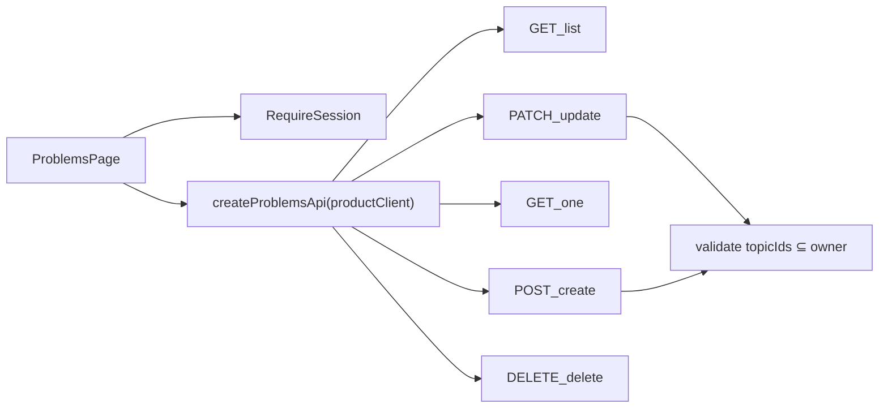

# Phase 6 — User-owned problem library execution plan

Status: **complete (2026-11-15).** See [PHASE_6_RESULTS.md](PHASE_6_RESULTS.md) for verification evidence, integration script, and Phase 7 handoff.

Outcome: an authenticated user can create, view, edit, and delete their own problems; assign multiple owned topics per problem; and browse a personal library (including topic-scoped lists) through the real API and protected frontend screens. Duplicate URLs within one account fail safely. Cross-account access fails without leaking ownership. Topic deletion removes associations only and **preserves** problem rows. OpenAPI and the shared typed client stay aligned. Completion toggles, search, combined filters, sorting beyond basic list defaults, and progress summaries remain Phase 7.

References: [execution plan](../PROJECT_EXECUTION_PLAN.md), [requirements](../backend/REQUIREMENTS.md) (FR-01, FR-02 associations, FR-06; FR-03/04/05 deferred), [Phase 0 decisions](PHASE_0_DECISIONS.md), [Phase 5 results](PHASE_5_RESULTS.md), [Phase 5 plan](PHASE_5_PLAN.md), [backend conventions](../backend/BACKEND_CONVENTIONS.md), [Drizzle conventions](../backend/DRIZZLE_CONVENTIONS.md), [frontend conventions](../cp-frontend/FRONTEND_CONVENTIONS.md), [API client](../cp-frontend/API_CLIENT.md).

## 1. Scope, prerequisites, and boundaries

### Prerequisites

- **Phase 3–4:** `AccessGuard`, session cookies, `RequireSession`, recovery-enabled `productClient`.
- **Phase 5:** `topics` table/API/UI; UUID topic ids; delete topic = row removal only today — Phase 6 adds `problem_topics` and **re-verifies** topic delete.
- **Phase 2:** transport, OpenAPI export/generation, `recoverAuth` on product operations.
- **Database:** apply the new problems migration only to a known-safe development or test database after inspection. Real PostgreSQL integration tests are required for URL uniqueness, association integrity, ownership, and topic-delete behavior.

### In scope

- `problems` and `problem_topics` tables, relations, and migration.
- **URL normalization** per FR-06 (trim; scheme/hostname case rules; strip fragments; preserve path and query).
- Authenticated problem **create, read (single + list), update (including topic set), delete** with documented contracts.
- **Atomic** create/update: problem fields + topic associations in one transaction; reject foreign topic ids not owned by the user.
- Unique **(`user_id`, `normalized_url`)** in PostgreSQL; duplicate → **409** with safe message (optionally include existing problem id for client navigation).
- `problems.api.ts` and protected routes: library list, add, edit, detail, delete confirm.
- List supports **pagination** and optional **`topicId`** filter for topic-scoped browsing (foundation for FR-04 topic view; full search/filters in Phase 7).
- Schema includes **`status`** (`solved` | `unsolved`) and nullable **`solved_at`** for Phase 7; Phase 6 create form may offer **“already solved”** on create only (FR-03 baseline), without library-wide solve/revert controls yet.
- Loading, empty, validation, duplicate URL, not-found, unavailable, and delete-confirmation states on the frontend.
- **Re-test topic delete** with associations: join rows removed; problems remain in library.

### Out of scope (defer to Phase 7+)

- Mark solved / revert unsolved controls in list and detail (beyond optional create-time “already solved”).
- Title/platform-id **search**, platform/status/**untagged** filters, sort matrix, progress summaries (FR-04, FR-05).
- CSV import, scraping, platform sync, bulk tag operations, sheets/collections.
- Restricting URLs to the three seeded `platforms` rows (reference data only; problems keep arbitrary HTTP/HTTPS URLs).
- SSR, BFF, Redis, new query libraries, raw `fetch` in components.

## 2. Intended organization

```text
backend/src/
  database/schema/
    problems/
      problems.table.ts
      problem-topics.table.ts   # join table
      index.ts
    relations.ts                # problems + topics + join
  modules/problems/
    problems.module.ts
    problems.controller.ts
    problems.service.ts
    problems.repository.ts
    problem-url.ts              # normalize + validate URL (FR-06)
    schemas/
      problems.schema.ts        # Zod + Swagger
  modules/topics/                 # extend delete path if join cleanup not DB-only

cp-frontend/src/
  lib/problems/
    messages.ts                   # ApiError mapping (optional)
  lib/api/modules/
    problems.api.ts
    problems.api.test.ts
  routes/
    problems.tsx                  # layout + RequireSession
    problems/index.tsx            # library list
    problems/new.tsx              # create (or problems/index + modal — prefer routes)
    problems/[id].tsx             # detail
    problems/[id]/edit.tsx        # edit (or single form route)
```

Use plural resource path `problems` under the API prefix (browser: `/api/problems`). Register `ProblemsModule` in `AppModule`. Follow the existing `topics/` Nest layout.



## Step 6.1 — Data model and URL normalization contract

### Work

- Add **`problems`** with at least: UUID `id`, `user_id` FK → `users.id` (`ON DELETE CASCADE`), `title`, `url`, `normalized_url`, optional `platform_problem_id`, optional `difficulty`, optional numeric `rating`, optional `notes`, `status` enum/text (`unsolved` default), nullable `solved_at`, `created_at` / `updated_at` (timestamptz).
- Enforce **unique (`user_id`, `normalized_url`)** in PostgreSQL.
- Add **`problem_topics`**: `problem_id` → `problems.id` (`ON DELETE CASCADE`), `topic_id` → `topics.id` (`ON DELETE CASCADE`), **unique (`problem_id`, `topic_id`)**; index for listing by `topic_id` and by `user_id` via problem.
- Register relations in the Drizzle v2 registry; export through domain barrels per `DRIZZLE_CONVENTIONS.md`.
- Implement **`problem-url.ts`**: parse/validate http(s) URLs; normalization rules from FR-06; unit tests for trim, host case, fragment strip, path/query preservation, rejection of invalid schemes.
- Define symmetric server limits before coding (recommended: title 1–200 code points; URL max length documented; notes cap consistent with product posture).
- Generate and review migration; do not alter Phase 5 `topics` migration.
- Document: deleting a **topic** cascades **join rows only**; deleting a **problem** cascades joins and removes the problem.

### Exit criteria

- Migration applies on a dedicated test database.
- Unit tests cover normalization edge cases and validation boundaries.
- `pnpm db:check` passes with the new snapshot.

**Pass:** schema matches FR-01 persistence and FR-06 comparison rules.

## Step 6.2 — Backend problems API

### Work

- Implement `ProblemsModule` with controller, service, repository. Every handler uses `AccessGuard`; identity from `req.auth` only.
- Endpoints (align with backend conventions):

  | Method | Path | Purpose |
  | --- | --- | --- |
  | `GET` | `/problems` | Paginated list for owner; optional `topicId` filter |
  | `POST` | `/problems` | Create problem + `topicIds` (optional array, default `[]`) |
  | `GET` | `/problems/:problemId` | Single problem including `topicIds` or embedded topic summaries |
  | `PATCH` | `/problems/:problemId` | Update fields + **replace** topic associations atomically |
  | `DELETE` | `/problems/:problemId` | Delete problem and joins (`204`) |

- List: `{ items, meta: { page, pageSize, total } }`; defaults `page=1`, `pageSize=25`, max `100`; stable sort (e.g. `updated_at` desc, tie-breaker `id`).
- Create/update body: required `title`, `url`; optional metadata fields; `topicIds` UUID array; optional `status` / `solvedAt` only where Phase 6 scope allows (create-time solved).
- On create with `status: solved`, set `solved_at` to server “now”; on create unsolved, `solved_at` null.
- Verify every `topicId` exists and **`topics.user_id === req.auth.user.id`** before insert; otherwise **400/404** with safe code (no cross-tenant topic existence leak).
- Errors: `400 VALIDATION_ERROR` with field details; `404 NOT_FOUND` for missing/unowned problem id; `409 PROBLEM_URL_IN_USE` (or consistent code) on unique violation; map PG unique violations by constraint name.
- Public JSON: problem fields needed for UI; do not expose `normalized_url` unless product requires it (default: omit).
- Swagger: tag `Problems`, Zod on inputs, explicit response schemas; export OpenAPI when stable.

### Exit criteria

- HTTP + PostgreSQL integration tests: CRUD happy path; duplicate URL create; cross-user id access → **404**; partial/invalid topic sets rejected; concurrent duplicate URL → one success, one **409**; **delete topic** removes joins, problem row remains; list `topicId` filter returns correct totals.
- Unit tests for service rules (association dedupe, empty topic list, solved_at on create).
- `pnpm build`, `pnpm lint`, `pnpm test`, and real DB integration suite pass.

**Pass:** backend satisfies FR-01, association slice of FR-02, and FR-06 without Phase 7 browse/progress features.

## Step 6.3 — Typed client and contract drift

### Work

- Add `createProblemsApi(client)` with `recoverAuth: true` on all operations.
- Narrow JSON like `topics.api.ts` / `auth.api.ts`; export types from generated `operations` where available.
- Paths: `/problems`, `/problems/{problemId}`; validate id strings; encode list query (`page`, `pageSize`, `topicId`).
- Add transport tests for pagination encoding, duplicate URL code, `NOT_FOUND`, empty list decoding.
- From `backend/`: `pnpm api:export` and `pnpm api:check`. From `cp-frontend/`: `pnpm api:generate` and `pnpm api:check`. Commit snapshot and generated types together.

### Exit criteria

- Generated types include all five problem operations; drift checks pass.
- `problems.api.test.ts` covers success decoding and contract failures without a live server.

**Pass:** frontend can call problems only through the shared client module with recovery enabled.

## Step 6.4 — Problem library UI (list and navigation)

### Work

- Add protected routes under `RequireSession` (layout shell consistent with `/topics`).
- **`/problems`:** load list via `createProblemsApi(auth.productClient)`; states: loading (no empty flash), empty invite, unavailable + retry, paginated list (or first page with note if `total > pageSize`).
- Row actions: open detail, edit, delete; external **Open link** uses `target="_blank"` with `rel="noopener noreferrer"` on stored URL.
- **`AuthNav`:** add **Problems** (or **Library**) alongside **Topics** for authenticated users — first-class product nav, demote template demo routes.
- Optional: from **`/topics`**, link each topic name to `/problems?topicId=<id>` (query param); library reads filter and refetches.
- Use `Panel`, `Button`, `.ui-field`, existing typography; no raw `fetch`.
- Do not refresh auth session on problem writes.

### Exit criteria

- Logged-in user sees library; empty and populated states behave; reload consistent.
- Logged-out user cannot open library routes.

**Pass:** primary “my problems” destination exists and lists real API data.

## Step 6.5 — Create, edit, detail, and delete flows

### Work

- **Create** (`/problems/new`): title, URL (with FR-06 hints), optional platform id / difficulty / rating / notes; multi-select or checkbox list of **owned topics** (load from `topicsApi.list`); optional **“Already solved”** checkbox setting initial status; submit disabled while pending; preserve input on validation/409.
- **Edit:** same fields + topic assignment; PATCH sends full topic id set (replace semantics).
- **Detail:** read-only view of fields, topic names, link button, navigation to edit; no solve toggle yet (Phase 7).
- **Delete:** native `<dialog>` confirm; explain associations and counts will drop (wording accurate for MVP).
- **Errors:** shared `messages.ts` mapping `PROBLEM_URL_IN_USE`, `VALIDATION_ERROR`, `NOT_FOUND`, rate limit/unavailable — mirror topics/auth tone.
- Accessibility: labels, `aria-invalid`, dialog focus, mobile gutters (`px-5 sm:px-8`).

### Exit criteria

- Manual browser path: create problem with two topics → appears in library and topic-filtered list → edit title/topics → delete → reload consistent.
- Duplicate URL shows server error without wiping unrelated fields.
- Assigning another user’s topic id fails safely (only possible via tampering; UI loads own topics only).

**Pass:** FR-01 management UX is usable end-to-end through proxy + cookies.

## Step 6.6 — Verification, documentation, and phase completion

### Work

- Run full frontend and backend verification matrices (build, typecheck, lint, unit, HTTP, PostgreSQL integration).
- Add **`scripts/test-problems-integration.mjs`** (or extend topics suite) on dedicated `TEST_DATABASE_URL` ending in `_test`: ownership, URL duplicate, associations, **topic delete with linked problems**, problem delete.
- Extend **`test-topics-integration.mjs`** (or problems suite) for Phase 5 retest: topic delete + surviving problems.
- Add `docs/PHASE_6_RESULTS.md`: files touched, commands, migration name, API samples (no secrets), browser checklist, known limits.
- Update `PROJECT_EXECUTION_PLAN.md` Phase 6 status only when exit criteria below are met.
- README nav note for Problems/Library when routes exist.

### Phase 6 exit criteria (overall)

Automated run: `cd backend && TEST_DATABASE_URL=…/practice_tracker_test pnpm verify:phase-6` (see [PHASE_6_RESULTS.md](PHASE_6_RESULTS.md)).

1. **Two accounts** each maintain independent problem libraries; same URL allowed across accounts.
2. **Cross-account** read/update/delete by problem id → **404** (or safe not-found).
3. **Duplicate URL** within one account → **409** on create and URL-changing update.
4. **Topic assignment** only to owned topics; atomic create/update; no duplicate problem–topic pairs.
5. **Delete topic** removes join rows; **problems remain** (FR-02, Phase 5 retest).
6. **Delete problem** removes row and joins.
7. **Frontend** uses `problems.api.ts` only; no product-level raw `fetch`.
8. **OpenAPI/generated types** committed and drift-clean.
9. **Real PostgreSQL tests** cover uniqueness, associations, and ownership; mocked-only evidence is insufficient for phase complete.

### Completion checklist

- [x] `problems` + `problem_topics` schema, migration, relations registered.
- [x] URL normalization module + unit tests; FR-06 rules documented in code.
- [x] Five authenticated endpoints implemented and Swagger-documented.
- [x] Repository ownership and topic-ownership checks on all paths.
- [x] `problems.api.ts` + tests; OpenAPI snapshot and `backend.d.ts` updated.
- [x] Protected library, create, edit, detail, delete-confirm UI.
- [x] Topic-scoped list filter wired (query or dedicated route).
- [x] Integration tests pass on dedicated database; topic-delete retest recorded.
- [x] `PHASE_6_RESULTS.md` written; execution plan status updated if all exit criteria met.

If PostgreSQL or Phase 4 browser prerequisites cannot run, record the exact blocker and leave Phase 6 **incomplete** rather than marking partial API-only work as done.

## Relationship to Phase 7

Phase 7 adds completion workflow (solve/revert, idempotent solved), search, filters, sorting, and progress summaries. Before closing Phase 7, re-run:

- Mark solved / revert updates `solved_at` and list displays consistently across topic views.
- Progress counts count each problem once overall while topic percentages use association sets.

Phase 6 should persist **problem primary keys (UUID)** and **status + `solved_at`** without renaming public API ids later. Avoid baking Phase 7 filter query shapes into Phase 6 list contracts beyond `topicId` and pagination unless required for the library screen.

## Risks

| Risk | Mitigation |
| --- | --- |
| Partial update leaves orphan joins | Single transaction for PATCH; replace association set in repository |
| URL normalization too aggressive | Lock behavior with FR-06 unit tests; no query/path stripping |
| Topic picker loads unbounded topics | Reuse `pageSize: 100` + short note when truncated |
| Duplicate URL UX | Return stable error code; optional `existingProblemId` in details for “open existing” link |
| Phase 5 topic delete wording | Update topics delete dialog if associations now exist |
| Large notes/titles in UI | Use realistic copy in manual testing; respect server limits |

**Next:** Execute Step **6.1** after reviewing target database migration history.