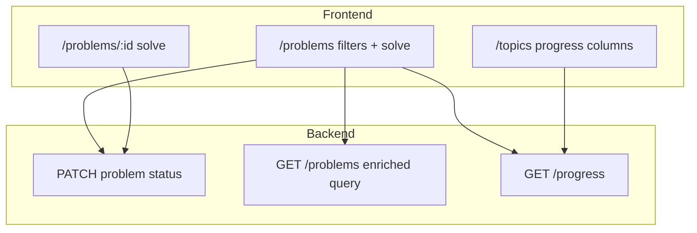

# Phase 7 — Completion, search, and progress execution plan

Status: **complete** — Steps **7.1–7.8** executed. Exit: `pnpm verify:phase-7` on `*_test` database; see [PHASE_7_RESULTS.md](PHASE_7_RESULTS.md).

Outcome: an authenticated user can **mark problems solved or revert to unsolved** with correct `solved_at` semantics; **search and combine filters** on the library (title, platform id, status, platform, topics, untagged); **sort and paginate** results; and see **overall and per-topic progress** that count each problem once while filtered views show accurate result totals. All behavior is owner-scoped, typed through the shared client, and backed by PostgreSQL integration tests—not mocks alone.

References: [execution plan](../PROJECT_EXECUTION_PLAN.md), [requirements](../REQUIREMENTS.md) (FR-03, FR-04, FR-05), [Phase 6 results](PHASE_6_RESULTS.md), [Phase 6 plan](PHASE_6_PLAN.md), [Phase 5 plan](PHASE_5_PLAN.md), [backend conventions](../BACKEND_CONVENTIONS.md), [Drizzle conventions](../DRIZZLE_CONVENTIONS.md), [frontend conventions](../solve-tracker-frontend/FRONTEND_CONVENTIONS.md), [API client](../solve-tracker-frontend/API_CLIENT.md).

## 1. Scope, prerequisites, and boundaries

### Prerequisites

- **Phase 6 complete:** `problems` / `problem_topics`, CRUD UI, `status` + `solved_at` columns, create-time “already solved”, list `topicId` filter, `verify:phase-6`.
- **Phase 5:** topics CRUD and `/topics` UI.
- **Phase 4:** session + `RequireSession`, `productClient` with `recoverAuth`.
- **Reference data:** seeded `platforms` rows (Codeforces, LeetCode, CodeChef) for **filter labels and host matching** only—problems remain arbitrary HTTP(S) URLs (Phase 0).

### In scope

| Requirement | Phase 7 deliverable |
| --- | --- |
| **FR-03** | Solve / revert via API; idempotent solved; `solved_at` set/clear/preserve rules; UI controls on library + detail |
| **FR-04** | Search (`title`, `platformProblemId`, case-insensitive); filters (status, platform slug, one or more topics **any-match**, untagged); sort (`title`, `createdAt`, `solvedAt`); default **newest added first** (`createdAt` desc, `id` tie-break); pagination with consistent `meta.total` |
| **FR-05** | Library-wide and per-topic totals (total / solved / unsolved, topic %); each problem counted once overall; 0% for empty topics; UI labels distinguish **full-library progress** vs **filtered result count** |

### Out of scope (Phase 8+ or deferred)

- Full MVP acceptance sweep, Playwright regression matrix, a11y audit (Phase 8).
- CSV import, scraping, auto-detect solved, attempt history, goals, sharing.
- Changing URL normalization (FR-06) or problem/topic ownership rules.
- Refreshing the auth session on product-data writes.
- New infrastructure (Redis, SSR, BFF).

### Design decisions to lock in Step 7.1

| Topic | Proposal |
| --- | --- |
| Completion API shape | Extend existing `PATCH /problems/:problemId` with optional `status: "solved" \| "unsolved"` only (no separate completion resource unless PATCH becomes awkward) |
| Platform filter | `platform` query = `platforms.slug`; match when problem `url` host is the same as parsed `platforms.base_url` host (case-insensitive). Unknown hosts → **no platform**; optional filter value `unknown` or omit |
| Multi-topic filter | `topicIds` repeated query or array; semantics **any** selected topic (FR-04 default) |
| Untagged | `untagged=true` → problems with zero `problem_topics` rows |
| Progress scope | New read-only `GET /progress` (or `/problems/progress`) returning overall + per-owned-topic aggregates in one response for the topics screen |



## 2. Intended organization

```text
src/modules/
  problems/
    problems.repository.ts     # filter/sort builders, completion patch
    problems.service.ts        # FR-03 transition rules
    schemas/problems.schema.ts # list query + status patch
  progress/                    # new module (preferred)
    progress.module.ts
    progress.controller.ts
    progress.service.ts
    progress.repository.ts
    schemas/progress.schema.ts

solve-tracker-frontend/src/
  lib/api/modules/
    problems.api.ts            # list query types, completion patch
    progress.api.ts              # new
  lib/problems/
    messages.ts                  # completion errors if needed
  routes/problems/index.tsx      # search/filter/sort/pagination + solve
  routes/problems/[id].tsx       # solve/revert
  routes/topics/index.tsx        # progress columns / summary strip
```

## Step 7.1 — Completion transitions (FR-03 backend)

### Work

- Allow `status` on `PATCH` (optional field); reject mixing unrelated fields when a dedicated “completion-only” PATCH is used—or allow combined PATCH but test completion paths explicitly.
- **Rules (service layer):**
  - `unsolved` → `solved`: set `solvedAt = now` (UTC timestamptz).
  - `solved` → `solved` (idempotent): keep existing `solvedAt`.
  - `solved` → `unsolved`: set `solvedAt = null`.
  - `unsolved` → `unsolved`: no-op on timestamps.
  - After revert, solving again sets a **new** `solvedAt`.
- Do not expose `solvedAt` as a writable client field; server-owned only.
- Unit tests for all transitions; extend `problems.service.spec.ts`.

### Exit criteria

- Integration: create unsolved → patch solved (timestamp) → patch solved again (same timestamp) → patch unsolved (null) → patch solved (new timestamp).
- Cross-account completion PATCH → **404**.

**Pass:** FR-03 persistence rules enforced before UI.

## Step 7.2 — Search, filters, sort, pagination (FR-04 backend)

### Work

- Extend `listProblemsQuerySchema` and repository `list()`:

  | Query param | Behavior |
  | --- | --- |
  | `q` | Case-insensitive substring on `title` OR `platform_problem_id` (SQL `ilike` or normalized comparison per conventions) |
  | `status` | `solved` \| `unsolved` |
  | `platform` | `platforms.slug`; host match on stored `url` |
  | `topicIds` | UUID array; **any** association match; still owner-scoped |
  | `untagged` | `true` → no join rows |
  | `topicId` | Keep Phase 6 single-topic filter (alias or subset of `topicIds`) |
  | `sort` | `title` \| `createdAt` \| `solvedAt` |
  | `order` | `asc` \| `desc`; default sort **`createdAt` desc** |
  | `page`, `pageSize` | Existing bounds (max 100) |

- `meta.total` must use the **same predicate** as `items` (filtered count).
- Document multi-topic **any** semantics in OpenAPI descriptions.
- Add repository or SQL tests for combined filters (e.g. `q` + `status` + `untagged`).
- Consider index review (`user_id`, `created_at`, `status`)—add migration only if explain plans warrant it.

### Exit criteria

- Integration matrix: untagged only; platform slug + status; `q` + topicIds; sort `solvedAt`; totals match row counts.
- Invalid query → **400 VALIDATION_ERROR** with safe details.

**Pass:** list contract matches FR-04 without breaking Phase 6 `topicId` clients.

## Step 7.3 — Progress summaries (FR-05 backend)

### Work

- Add authenticated `GET /progress` (name TBD—keep stable in OpenAPI):
  - `overall: { total, solved, unsolved }` — distinct problems for owner.
  - `topics: [{ id, name, total, solved, unsolved, percentComplete }]` — per owned topic via join; **0%** when `total === 0`.
- Percent = `round(solved / total * 100)` or fixed decimal policy—document one rule.
- Progress reflects **full library**, not current list filters (FR-05 labeling).
- Owner-only; no cross-user leakage.

### Exit criteria

- Integration: one problem, three topics → overall `total: 1`, each topic `total: 1`; mark solved updates aggregates; revert restores; delete problem drops counts.
- Two accounts: isolated libraries.

**Pass:** FR-05 counts match acceptance examples in REQUIREMENTS §Acceptance.

## Step 7.4 — Typed client and contract drift

### Work

- Extend `createProblemsApi`: encode new list query params; optional `setStatus(id, status)` or typed `update` helper for completion-only calls.
- Add `createProgressApi(client)` with `recoverAuth: true`.
- Vitest transport tests for query serialization (arrays, booleans) and response decode.
- `pnpm api:export` / `api:check` in both packages; commit `openapi.json` + `backend.d.ts`.

### Exit criteria

- Drift checks pass; no raw `fetch` in new code paths.

**Pass:** frontend can implement Phase 7 UI solely through API modules.

## Step 7.5 — Completion controls (FR-03 UI)

### Work

- **Library row** and **detail**: Mark solved / Revert with pending state, disabled while in-flight.
- On success: update local row or refetch list slice; on failure: `problemFormMessage` + keep prior status.
- Optimistic updates **optional**; if used, rollback on error and ignore stale responses (document pattern in route code).
- Do not refresh auth session on completion writes.

### Exit criteria

- Manual: solve from list and detail; reload shows consistent status and `solvedAt` on detail.
- Idempotent double-click solved does not change timestamp (verify via detail).

**Pass:** primary “mark solved” workflow works end-to-end.

## Step 7.6 — Browse UI: search, filters, sort, pagination (FR-04)

### Work

- Replace fixed `pageSize: 100` library load with **user-facing pagination** (or “Load more”) and server-driven totals.
- Filter panel or toolbar: search box, status, platform dropdown (from static slug list aligned with seed), topic multi-select (owned topics), untagged toggle.
- Sort control matching API `sort` + `order`.
- Preserve query in URL (`URLSearchParams`) for shareable/reloadable library state where practical.
- Empty states: no problems, no matches for filter, empty topic context.
- Show **platform** in list (derived display from URL host or optional field—match product copy in REQUIREMENTS).

### Exit criteria

- Manual: combine title search + unsolved + platform + topic; pagination; clear filters.
- `meta.total` matches visible pagination.

**Pass:** FR-04 browse UX on real API.

## Step 7.7 — Progress UI (FR-05)

### Work

- **Library header:** overall total / solved / unsolved; subtitle clarifies counts are **whole library** when filters active; show **“Showing N results”** from list `meta.total`.
- **Topics list:** per-topic solved/total and % (from `GET /progress` or embedded fields).
- Use `tabular-nums` for counts; 0% for empty topics.

### Exit criteria

- Manual: one solved problem with three topics → library shows 1 solved overall; each topic 1/1 (100%).
- Filter library → progress headline unchanged; result count updates.

**Pass:** FR-05 labeling and math visible in UI.

## Step 7.8 — Verification, documentation, and phase completion

### Work

- Run full matrices: solve-tracker-backend / solve-tracker-frontend build, typecheck, lint, unit, e2e (mocked), `api:check`.
- Add or extend `scripts/test-problems-phase7-integration.mjs` (or grow `test-problems-integration.mjs`) on `TEST_DATABASE_URL` `*_test`: completion, filters, progress, ownership.
- Add `scripts/verify-phase-7-exit.mjs` + `pnpm verify:phase-7` mapping plan exit criteria.
- `docs/PHASE_7_RESULTS.md`: commands, samples, browser checklist, known limits.
- Update `PROJECT_EXECUTION_PLAN.md` Phase 7 status when exit criteria met.
- Re-run `verify:phase-5` / `verify:phase-6` smoke if touch regression-sensitive paths.

### Phase 7 exit criteria (overall)

Automated target: `cd solve-tracker-backend && TEST_DATABASE_URL=…/practice_tracker_test pnpm verify:phase-7` (to be added in Step 7.8).

1. **Completion:** solve, idempotent solved, revert, solve-again-new-timestamp; consistent across list/detail after reload.
2. **Search/filter:** title and platform id search; combined status/platform/topic/untagged filters; **any** multi-topic; stable sort; paginated totals consistent.
3. **Progress:** overall counts count each problem once; per-topic % correct; empty topic 0%; UI distinguishes progress vs filtered result count.
4. **Ownership:** progress and filtered lists scoped to owner; foreign ids → **404** on writes.
5. **Client:** problems + progress APIs only; no product-level raw `fetch`.
6. **Contracts:** OpenAPI/types drift-clean.
7. **PostgreSQL:** integration covers completion, filter combinations, and progress—not mocked-only.

### Completion checklist

- [x] FR-03 completion rules in service + PATCH contract + tests.
- [x] FR-03 solve/revert controls on library list and problem detail.
- [x] FR-04 list query documented and implemented; Phase 6 `topicId` still works.
- [x] FR-04 library browse UI (search, filters, sort, pagination).
- [x] FR-05 `GET /progress` (or equivalent) + tests.
- [x] `problems.api.ts` + `progress.api.ts` + tests; types committed.
- [x] Library search/filter/sort/pagination + solve controls.
- [x] Topics/library progress display with correct labeling.
- [x] Integration + `verify:phase-7` pass on dedicated database.
- [x] `PHASE_7_RESULTS.md` written; execution plan status updated.

## Relationship to Phase 8

Phase 8 runs the **full MVP acceptance checklist** (keyboard, mobile, auth edge cases, two-account browser passes, template route cleanup). Phase 7 should not block on Playwright coverage but should leave hooks testable (stable `data-testid` or roles only if already convention—do not over-instrument).

## Risks

| Risk | Mitigation |
| --- | --- |
| Filter SQL complexity | Repository tests per filter; explain on realistic datasets |
| Platform host mismatch | Unit-test host parser against seed `base_url` values |
| Progress drift after solve | Refetch progress endpoint after completion mutation (local invalidation scope) |
| Sort default vs Phase 6 | Document breaking UX change from `updatedAt` to `createdAt` default in RESULTS |
| Multi-topic query encoding | Follow existing client query patterns; vitest round-trip |
| Optimistic race | Serialize per-problem actions or disable optimistic for MVP |

**Next:** Execute **Step 7.1** after reviewing current `updateProblemSchema` and PATCH handler for safe `status` addition.