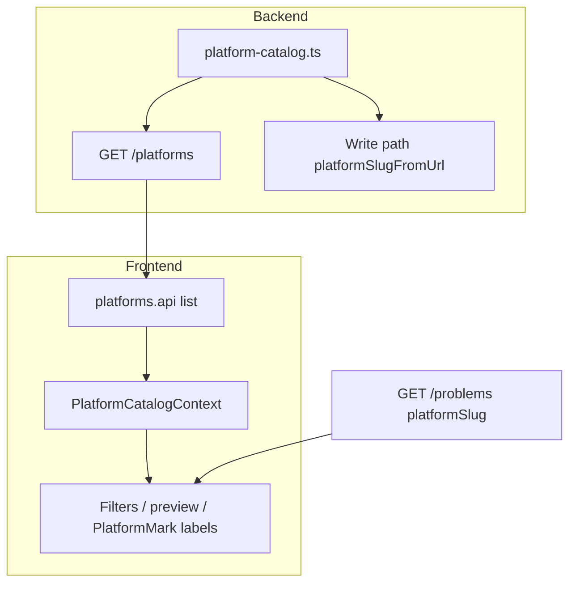
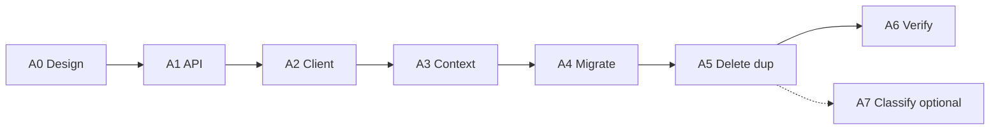

# Platform catalog from API — phased execution plan

**Status:** **A0–A6 complete** (2026-11-18); **A7 deferred** (not planned).  
**Codename:** `PLATFORM-API` (phases **A0–A7** below). **Results:** [A0](PLATFORM_CATALOG_API_A0_RESULTS.md) · [A1](PLATFORM_CATALOG_API_A1_RESULTS.md) · [A2](PLATFORM_CATALOG_API_A2_RESULTS.md) · [A3](PLATFORM_CATALOG_API_A3_RESULTS.md) · [A4](PLATFORM_CATALOG_API_A4_RESULTS.md) · [A5](PLATFORM_CATALOG_API_A5_RESULTS.md) · [A6](PLATFORM_CATALOG_API_A6_RESULTS.md) · [**Summary**](PLATFORM_CATALOG_API_RESULTS.md).

**Problem (historical):** Judge metadata was duplicated in frontend and backend TypeScript catalogs; drift was gated by file-to-file checks. **Current (A0–A6):** Canonical catalog is **`solve-tracker-backend/src/shared/platform-catalog.ts`** only; the SPA loads **`GET /platforms`** and uses `platform-slugs.ts` for OpenAPI-aligned decode guards. Contract drift is gated by **`pnpm verify:platform-api`**.

**Outcome:** The **backend** exposes a stable, cacheable **platform reference API**. The SPA loads that list for filter options and client-side URL preview. Server-side classification (`platformSlugFromUrl`, seed, Zod enums) uses the same module on the API host.

**References:** [REQUIREMENTS.md](../REQUIREMENTS.md) (§5 platform entity), [platform-catalog.ts](../src/shared/platform-catalog.ts), [PLATFORM_CLASSIFICATION_PHASED_PLAN.md](PLATFORM_CLASSIFICATION_PHASED_PLAN.md), [solve-tracker-frontend FRONTEND_CONVENTIONS.md](../../solve-tracker-frontend/FRONTEND_CONVENTIONS.md), [API_CLIENT.md](../../solve-tracker-frontend/API_CLIENT.md), [FRONTEND_HARDENING_PHASED_PLAN.md](../../solve-tracker-frontend/docs/FRONTEND_HARDENING_PHASED_PLAN.md) (DATA-1 baseline).

---

## 1. Scope, prerequisites, and boundaries

### Prerequisites

- **PLATFORM-CLS complete** (P1–P5): `platform_slug` column, list `?platform=` on slug, `platformSlug` on problem responses.
- **OpenAPI pipeline** healthy: `solve-tracker-backend` `pnpm api:export`, `solve-tracker-frontend` `pnpm api:generate` (scripts use `../solve-tracker-backend`—see [REPO-1](../../solve-tracker-frontend/docs/FRONTEND_HARDENING_PHASED_PLAN.md)).
- **No in-flight catalog edits** blocking a coordinated release (or plan a catalog + backfill ops window per PLATFORM-CLS § Ops).

### In scope

| Area | Deliverable |
| --- | --- |
| **API** | `GET /platforms` (read-only list), OpenAPI + generated frontend types |
| **Backend** | Thin module; response mapped from `PLATFORM_CATALOG` (not ad-hoc DB reads unless explicitly chosen in A0) |
| **Frontend** | `platforms.api.ts`, catalog store/context, migration of all `PLATFORM_CATALOG` consumers |
| **Caching** | HTTP cache headers on reference route; in-memory SPA cache with explicit invalidation story |
| **Verification** | `pnpm verify:platform-api` (+ `verify:platform-api:full` pre-release); `verify:catalog` alias |
| **Docs** | API_CLIENT, FRONTEND_CONVENTIONS, this plan → RESULTS file when done |

### Out of scope (defer unless product requests)

- User-editable platforms or admin CRUD.
- Restricting problem URLs to catalog hosts only.
- **`POST /platforms/classify`** (URL → slug over the wire)—listed as optional **A7** only.
- Storing `url_hosts` in PostgreSQL and serving from DB (possible future; not default in A0).
- Changing `platform_slug` write rules or `LIST_PLATFORM_FILTER_SLUGS` semantics (`other` remains a filter value, not a catalog row).

### Design decisions (lock in A0)

| Topic | Recommended decision | Alternative (document if chosen) |
| --- | --- | --- |
| **Runtime source** | Map `GET /platforms` from `PLATFORM_CATALOG` in code | `SELECT * FROM platforms` — requires JSON/`url_hosts` column for parity |
| **Auth** | **Public** read (no session): reference data; landing strip can use same route | Session-only: simpler abuse model, breaks anonymous marketing use |
| **Response shape** | `{ items: [{ slug, name, baseUrl, urlHosts }] }` | Flat array; envelope matches existing list modules |
| **Synthetic `other`** | **Omit** from `GET /platforms`; filters append `other` client-side (today’s `LIST_PLATFORM_FILTER_SLUGS`) | Include `other` with empty `urlHosts` for one-shot filter dropdown |
| **SSR** | **Client fetch** after hydrate for `/app`; optional SSR prefetch in a later sub-phase | Block SSR landing on API (keep static subset on marketing) |
| **Fallback** | None in production after A5 | Emergency bundled snapshot (only if product requires offline-first) |



---

## 2. Intended organization (target end state)

```text
backend/
  src/shared/platform-catalog.ts              # single canonical module (unchanged role)
  src/modules/platforms/
    platforms.module.ts
    platforms.controller.ts
    platforms.service.ts
    schemas/platforms.schema.ts                 # Zod + OpenAPI
  scripts/
    verify-platform-api.mjs                   # optional exit gate (A6)
  openapi.json                                # GET /platforms

solve-tracker-frontend/
  src/lib/api/modules/platforms.api.ts
  src/lib/platforms/
    catalog-runtime.ts                          # pure helpers: slugFromUrl(entries, url), etc.
    platform-catalog-context.tsx                # load + cache + accessors
    catalog.ts                                  # re-exports context hooks + runtime helpers
  # platform-catalog.ts                         # DELETED (A5)
  scripts/
    verify-platform-api.mjs                     # contract gate (A6)
```

**Backend remains authoritative** for slug assignment on save; **frontend catalog** becomes a **cached mirror** of `GET /platforms`, not a second source file.

---

## 3. Phase overview

| Phase | Name | Backend | Frontend | Delivers |
| --- | --- | --- | --- | --- |
| **A0** | Design lock | — | — | Decisions table signed off, path fixes in verify scripts |
| **A1** | Reference API | `GET /platforms` | — | OpenAPI, unit test, cache headers |
| **A2** | Typed client | — | `platforms.api.ts` | Generated types, smoke test |
| **A3** | Catalog context | — | Provider + cache | Load strategy, error/loading UX |
| **A4** | Consumer migration | — | Call-site updates | Filters, forms, dashboard, landing |
| **A5** | Remove duplicate file | — | Delete static catalog | Single source via API + server module |
| **A6** | Verification & docs | Contract script | CI/docs | Replace drift check; conventions updated |
| **A7** | Optional classify API | `POST /platforms/classify` | Use on paste blur | Server-only URL rules on client (optional) |



**Rollout:** Ship **A1** with any backend deploy; ship **A2–A5** in one frontend release when migration is complete (partial A4 without A5 reintroduces dual sources briefly—avoid except behind a feature flag).

---

## A0 — Design lock and repo hygiene

**Status:** **complete** (2026-11-18). See [PLATFORM_CATALOG_API_A0_RESULTS.md](PLATFORM_CATALOG_API_A0_RESULTS.md).

**Outcome:** No ambiguity on auth, payload, or data source before implementation.

### Work

1. Confirm **public vs authenticated** `GET /platforms` with product (default: public).
2. Confirm **omit `other`** from list response; document filter UI still appends `other`.
3. Fix script paths that still say `solve-tracker-backend` / `solve-tracker-frontend`:
   - [`solve-tracker-frontend/scripts/verify-platform-api.mjs`](../../solve-tracker-frontend/scripts/verify-platform-api.mjs)
   - `solve-tracker-frontend/package.json` `api:generate` → `../solve-tracker-backend`
4. Add this plan to backend docs index / README “related plans” if applicable.

### Exit criteria

- Written sign-off on A0 decision table (issue/PR description is enough).
- `pnpm verify:repo-paths` green (if present).

---

## A1 — Backend reference API

**Status:** **complete** (2026-11-18). See [PLATFORM_CATALOG_API_A1_RESULTS.md](PLATFORM_CATALOG_API_A1_RESULTS.md).

**Outcome:** Documented, testable list endpoint; no frontend dependency yet.

### Work

1. Add `PlatformsModule` registered in `app.module.ts`.
2. `PlatformsService.list()` → map `PLATFORM_CATALOG` to DTO (include `urlHosts`).
3. `PlatformsController`:
   - `GET /platforms`
   - `@Header('Cache-Control', 'public, max-age=3600')` (tune: catalog changes are rare)
   - **No** `AccessGuard` if public; still apply `AuthSecurityGuard` only if consistent with other public routes (health pattern).
4. Zod response schema + `@ApiTags('Platforms')` + `@ApiResponse({ standardSchema })`.
5. Unit test: item count matches `PLATFORM_CATALOG.length`; slugs unique.
6. Optional HTTP/integration test: status 200, shape matches schema.
7. Run `pnpm api:export` and commit `openapi.json`.

### Exit criteria

- `pnpm build` and backend unit tests green.
- OpenAPI documents `GET /platforms` with required fields.
- Manual `curl` / Swagger returns same slugs as `PLATFORM_SLUGS`.

**Pass:** Backend-only deploy does not break existing clients (new route additive).

---

## A2 — Frontend typed client

**Status:** **complete** (2026-11-18). See [PLATFORM_CATALOG_API_A2_RESULTS.md](PLATFORM_CATALOG_API_A2_RESULTS.md).

**Outcome:** Generated types and a thin API module; no UI wiring.

### Work

1. `pnpm api:generate` from `solve-tracker-frontend` (after A1 OpenAPI).
2. Add [`solve-tracker-frontend/src/lib/api/modules/platforms.api.ts`](../../solve-tracker-frontend/src/lib/api/modules/platforms.api.ts):
   - `listPlatforms()` → typed `items`
   - Use product `api` client; `recoverAuth: false` if route is public (faster, no session needed).
3. Unit test: mocks `fetch`, asserts path `/platforms`.

### Exit criteria

- `pnpm check` green.
- No route imports yet.

---

## A3 — Catalog context and cache

**Status:** **complete** (2026-11-18). See [PLATFORM_CATALOG_API_A3_RESULTS.md](PLATFORM_CATALOG_API_A3_RESULTS.md).

**Outcome:** One place in the SPA holds platform entries and exposes helpers.

### Work

1. Create `platform-catalog-context.tsx` (or equivalent store):
   - State: `entries`, `status` (`idle` | `loading` | `ready` | `error`)
   - `loadCatalog()` idempotent; dedupe in-flight promise
   - Persist in memory for session; optional `sessionStorage` version key if product wants survive refresh without refetch (default: memory-only + HTTP cache).
2. Refactor [`catalog-runtime.ts`](../../solve-tracker-frontend/src/lib/platforms/catalog-runtime.ts) (new):
   - Move **pure** functions from today's `platform-catalog.ts`: `platformSlugFromUrl`, `platformLabelBySlug`, `platformPreviewFromUrl`, etc., taking `entries` as first argument or closed over store snapshot.
3. Mount provider:
   - **Option A (recommended):** Under authenticated app shell only (`routes/app.tsx`)—eager load on first `/app` entry.
   - **Option B:** Root `AuthProvider` sibling for landing strip—requires public `GET /platforms`.
4. Expose hooks: `usePlatformCatalog()`, `usePlatformFilterOptions()` (catalog + synthetic `other`).

### Exit criteria

- Provider test: loading → ready with mocked API.
- App shell renders with catalog loading placeholder or suspense-friendly pattern per [FRONTEND_CONVENTIONS](../../solve-tracker-frontend/FRONTEND_CONVENTIONS.md).

---

## A4 — Migrate consumers

**Status:** **complete** (2026-11-18). See [PLATFORM_CATALOG_API_A4_RESULTS.md](PLATFORM_CATALOG_API_A4_RESULTS.md).

**Outcome:** No imports from static `PLATFORM_CATALOG` in feature code (except transitional re-export).

### Inventory (grep before starting)

| Consumer area | Typical files | Notes |
| --- | --- | --- |
| Library filters | `browse-query`, problems list toolbar | `PLATFORM_FILTER_OPTIONS` → hook |
| Problem form | `ProblemFormFields`, preview helpers | Wait for `ready` before preview |
| Display | `PlatformMark`, `catalog-runtime` | Prefer API `platformSlug` over re-parse |
| Dashboard | platform grid, progress labels | Slug labels from store |
| Landing | `landing-copy.ts` platform strip | Static subset **or** public fetch in A3 Option B |
| Tests | `platform-display.test.ts`, etc. | Fixture entries array, not deleted file |

### Work

1. Replace `PLATFORM_FILTER_OPTIONS` / direct catalog imports with context hooks.
2. Ensure list/detail still use **`platformSlug` from API** for rows (PLATFORM-CLS P4); catalog only for labels and filters.
3. Loading UX: disable platform filter until `ready` or show skeleton chips (no wrong empty list).
4. Error UX: inline retry on catalog failure; do not block unrelated app areas if only filters need catalog.

### Exit criteria

- `rg PLATFORM_CATALOG solve-tracker-frontend/src` — zero matches outside `platform-catalog.ts` and migration shims.
- Manual: library filter, add-problem URL preview, dashboard platform names work against live API.
- Unit tests updated with shared `mockPlatformEntries` fixture.

**Pass:** Behavior matches pre-refactor for known URLs and filter slugs.

---

## A5 — Remove duplicate catalog file

**Status:** **complete** (2026-11-18). See [PLATFORM_CATALOG_API_A5_RESULTS.md](PLATFORM_CATALOG_API_A5_RESULTS.md).

**Outcome:** Frontend has no second copy of judge definitions.

### Work

1. Delete `solve-tracker-frontend/src/lib/platforms/platform-catalog.ts`.
2. Update `catalog.ts` barrel to export context + runtime only.
3. Remove any build-time duplication assumptions from docs.
4. Keep `backend/src/shared/platform-catalog.ts` as the **only** definition; seed still uses `PLATFORM_SEED_ROWS`.

### Exit criteria

- Frontend build and tests green without static catalog file.
- Adding a judge requires **backend catalog edit + deploy** only; frontend picks up on next `GET /platforms` (document in ops).

**Pass:** No `pnpm verify:catalog` file-to-file drift check needed for frontend file (replaced in A6).

---

## A6 — Verification, ops, and documentation

**Status:** **complete** (2026-11-18). See [PLATFORM_CATALOG_API_A6_RESULTS.md](PLATFORM_CATALOG_API_A6_RESULTS.md) and [PLATFORM_CATALOG_API_RESULTS.md](PLATFORM_CATALOG_API_RESULTS.md).

**Outcome:** CI and contributor docs match API-backed catalog.

### Work

1. **Replace `verify:catalog`** with one of:
   - **Option B (recommended):** `verify-platform-api.mjs` — import backend `PLATFORM_CATALOG` and assert OpenAPI example or live response shape in integration test job.
   - **Option C:** HTTP test against running backend in CI (`GET /platforms` length/slugs).
2. Update:
   - [`solve-tracker-frontend/FRONTEND_CONVENTIONS.md`](../../solve-tracker-frontend/FRONTEND_CONVENTIONS.md) § Platform catalog
   - [`solve-tracker-frontend/API_CLIENT.md`](../../solve-tracker-frontend/API_CLIENT.md) — document `platforms.api.ts`
   - [`solve-tracker-frontend/docs/DEPLOY.md`](../../solve-tracker-frontend/docs/DEPLOY.md) — remove “edit both files” where obsolete
   - [`backend/docs/PLATFORM_CLASSIFICATION_PHASED_PLAN.md`](PLATFORM_CLASSIFICATION_PHASED_PLAN.md) § Ops — point to backend-only catalog edit + optional backfill
3. Add **`PLATFORM_CATALOG_API_RESULTS.md`** when complete (status table like other phase RESULTS).
4. Optional aggregate gate: `pnpm verify:platform-api` chaining export, types, and contract test.

### Exit criteria

- CI/docs no longer instruct “edit both platform-catalog.ts files”.
- New contributor flow: change `backend/src/shared/platform-catalog.ts` → migrate/seed as today → deploy API → clients refresh list.

---

## A7 — Optional: server-side URL classify

**Status:** **deferred** — not planned; client preview uses loaded catalog `urlHosts` (post-A4/A5).

**Outcome:** Client can drop `urlHosts` parsing for add/edit preview (not required for PLATFORM-API completion).

### Work

1. `POST /platforms/classify` body `{ url: string }` → `{ slug: PlatformSlug | 'other' }` using `platformSlugFromUrl` + same rules as write path.
2. Rate-limit or cap body size; public or session per A0.
3. Frontend: debounced call on URL blur instead of local `platformSlugFromUrl`.

### Exit criteria

- Integration test: known hosts → expected slug; garbage → `other` or validation error per schema.

**Defer** unless bundle size or “hide host rules” is a product goal.

---

## 4. Ops — catalog updates (after PLATFORM-API)

When adding or changing a judge:

1. Edit **`backend/src/shared/platform-catalog.ts`** only (`urlHosts`, name, `baseUrl`).
2. Run backend unit tests + `platform-catalog.spec.ts`.
3. Deploy **backend** (updates `GET /platforms`, write path, seed rows on next `pnpm db:seed`).
4. Run **`pnpm db:backfill:platform-slugs`** on environments with existing problems if host rules changed (unchanged from PLATFORM-CLS).
5. Frontend clients automatically receive new entries on next catalog fetch (no frontend file edit).

**Cache bust:** Bump `ETag` / shorten `max-age` on first deploy after catalog change, or accept up to `max-age` staleness for labels/filters only (stored `platform_slug` on problems remains correct after backfill).

---

## 5. Rollout order and deployment

| Order | Phase | Depends on | Safe to deploy alone? |
| --- | --- | --- | --- |
| 1 | A0 | — | Yes (docs/scripts) |
| 2 | A1 | A0 | Yes (additive API) |
| 3 | A2 | A1 | Yes (unused client) |
| 4 | A3 | A2 | Yes (provider unused) |
| 5 | A4 | A3 | **Coordinated** — needs A1 live |
| 6 | A5 | A4 | With A4 |
| 7 | A6 | A5 | Yes |
| 8 | A7 | A1 | Optional later |

**Simplest release:** Backend A1 first. Frontend A2–A5 single PR/release. Avoid shipping A5 before A4 completes.

---

## 6. Risks and mitigations

| Risk | Mitigation |
| --- | --- |
| Catalog fetch fails on first `/app` visit | Retry UI; optional short-lived cached response from HTTP cache; do not clear session |
| Stale filter labels after catalog deploy | HTTP `Cache-Control` + document ops; labels cosmetic vs stored slug |
| Landing needs platforms before API | Keep static slug subset in `landing-copy.ts` or public A3 Option B |
| SSR / auth gate blocks anonymous `GET /platforms` | A0: public route; proxy `/api` same as health |
| Type drift (`PlatformSlug` union) | Generate from OpenAPI; avoid hard-coded slug unions in new code |
| Regression in URL preview | A4 tests with fixture entries; compare against backend `platform-catalog.spec.ts` vectors |
| Removing `verify:catalog` too early | Run A6 before A5 merge or keep drift check until API contract test lands |

---

## 7. Success metrics

- **Zero** duplicate `PLATFORM_CATALOG` array in `solve-tracker-frontend/src`.
- All platform **filter options** and **URL preview** use loaded catalog entries.
- **Display** of stored problems still prefers `platformSlug` from problem API (no regression to URL re-parse on list rows).
- OpenAPI + generated types include `GET /platforms`.
- Contributor docs describe **one** catalog edit location on the backend.
- Optional: CI gate proves API list matches `PLATFORM_CATALOG` length and slug set.

---

## 8. Testing checklist (manual)

- [ ] Anonymous: `GET /platforms` (if public) without cookies.
- [ ] Logged in: library platform filter shows all catalog slugs + Other.
- [ ] Add problem: paste LeetCode / unknown URL → preview label matches server save slug.
- [ ] Dashboard platform grid labels match progress slugs.
- [ ] Hard refresh on `/app/problems` — filters populate after load.
- [ ] Deploy backend catalog change only — new slug appears in UI after cache TTL or hard refresh.

---

## 9. Related work (not blocking)

- Profile module, terminal auth, media upload — independent.
- DB-only platform table as runtime source — future migration project if ops want SQL-managed judges.
- Shared npm package for catalog — unnecessary if API is the contract.

---

**Next action:** Complete **A0** design lock, then implement **A1** `GET /platforms`.