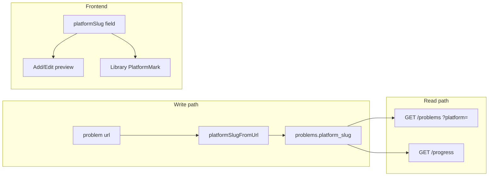

# Platform classification — phased execution plan

**Status:** **complete** — **P1–P5** (2026-11-17).  
**Codename:** `PLATFORM-CLS` (phases **P1–P5** below).

**Problem:** Platform was implied by `problems.url` but **was not stored** before P1. List filter and progress now use `platform_slug` (P3); the frontend may still parse URLs for display until P4. Catalog `urlHosts` can drift from stored slugs on old rows until backfill. REQUIREMENTS §5 lists **platform** on the Problem entity; the schema persists `platform_slug`; writes set it server-side (P2).

**Outcome:** One canonical **`platform_slug`** per problem, set from the URL via the **same** catalog logic everywhere; indexed list filters and SQL-friendly progress; API returns `platformSlug` for UI; optional form **preview** (no manual picker required for MVP robustness).

**References:** [REQUIREMENTS.md](../REQUIREMENTS.md) (FR-02, FR-04, §5 entities), [PHASE_7_PLAN.md](PHASE_7_PLAN.md) (current platform filter), [platform-catalog.ts](../src/shared/platform-catalog.ts), [solve-tracker-frontend platform catalog](../../solve-tracker-frontend/src/lib/platforms/platform-catalog.ts), [FRONTEND_CONVENTIONS.md](../../solve-tracker-frontend/FRONTEND_CONVENTIONS.md), [DRIZZLE_CONVENTIONS.md](../DRIZZLE_CONVENTIONS.md), [API_CLIENT.md](../../solve-tracker-frontend/API_CLIENT.md).

## 1. Scope, prerequisites, and boundaries

### Prerequisites

- **Phase 7 complete** (library filters, progress, `pnpm verify:phase-7` on a `*_test` database).
- **Catalog drift gate:** `pnpm verify:catalog` (frontend) keeps judge lists aligned.
- **No open URL-normalization (FR-06) redesign** in this effort.

### In scope

| Area | Deliverable |
| --- | --- |
| **Database** | `problems.platform_slug` column, index, backfill migration |
| **Write path** | Set / refresh slug on create and when `url` changes on update |
| **Read path** | List `?platform=` filters on column; progress aggregates from column |
| **API** | `platformSlug` on problem responses; OpenAPI + frontend types |
| **UX** | Read-only detected platform on add/edit form; clearer “judge problem ID” label |
| **Verification** | Integration tests + `pnpm verify:platform-cls` (new script) |

### Out of scope (defer unless product requests)

- User **override** of platform (writable slug independent of URL).
- Restricting creates to seeded `platforms` only (arbitrary HTTPS URLs remain valid).
- Automatic metadata lookup (title/difficulty from judge APIs).
- Replacing `platform_problem_id` semantics or duplicate detection rules.
- Changing `normalized_url` rules.

### Design decisions (lock in P1)

| Topic | Decision |
| --- | --- |
| Column | `platform_slug text not null default 'other'` on `problems` |
| Known judges | Value ∈ `PLATFORM_SLUGS` from shared catalog |
| Unknown / non-matching host | Store `'other'` (not `NULL`) so filters and progress stay explicit |
| Computation | `platformSlugFromUrl(url) ?? 'other'` at write time only; **no client-supplied slug** |
| `platforms` table | Keep reference seed (`slug`, `name`, `base_url`); **stop** using hostname `ILIKE` for list filters after P3 |
| Catalog change ops | Document one-shot backfill script when `urlHosts` change (re-run slug from URL) |
| Optional FK | **No FK** to `platforms` if `'other'` is not a row; validate in Zod/service |



## 2. Intended organization

```text
solve-tracker-backend/
  src/database/schema/problems/problems.table.ts   # platform_slug column
  src/database/migrations/                         # new migration + optional backfill in migration or script
  src/shared/platform-catalog.ts                   # existing resolver (single source)
  src/modules/problems/
    problems.repository.ts                         # filter by platform_slug
    problems.service.ts                            # set slug on create/update url
    problem-platform-filter.ts                     # deprecate ILIKE path after P3
    schemas/problems.schema.ts                     # response.platformSlug
  src/modules/progress/
    progress.repository.ts                           # GROUP BY platform_slug (preferred)
  scripts/
    verify-platform-cls.mjs                        # exit gate
    backfill-problem-platform-slugs.ts             # optional re-run after catalog edits
    verify-platform-p1.mjs                       # P1 exit gate
    verify-platform-p2.mjs                       # P2 exit gate
    verify-platform-p3.mjs                       # P3 exit gate
    verify-platform-p4.mjs                       # P4 exit gate

solve-tracker-frontend/
  src/lib/api/modules/problems.api.ts              # types from OpenAPI
  src/components/problems/ProblemFormFields.tsx    # preview + copy
  src/components/platforms/PlatformMark.tsx        # prefer slug prop when present
  docs/ or FRONTEND_CONVENTIONS — short note on stored slug
```

## P1 — Schema and migration

**Status:** **complete** (migration `20261117175859_add-problem-platform-slug`). After migrate, `pnpm db:seed` backfills `platform_slug` on existing problems (shared seed helper); use `pnpm db:backfill:platform-slugs` for catalog-only re-runs. Gate: `TEST_DATABASE_URL=…/_test pnpm verify:platform-p1`.

### Work

1. Add `platform_slug` to Drizzle `problems` table (`text`, not null default `'other'` **or** nullable with backfill — prefer **not null** after backfill with default only for migration safety).
2. Add index `(user_id, platform_slug)` for owner-scoped filters.
3. Generate and commit Drizzle migration.
4. Data migration step in same migration or follow-up SQL:
   - For each row: `platform_slug = platformSlugFromUrl(url) ?? 'other'` (run via small TS script in migration transaction if needed).

### Exit criteria

- `pnpm db:migrate` on empty and existing dev DB succeeds.
- Spot-check: LeetCode / Codeforces / unknown host rows get expected slugs.
- No change to `platform_problem_id` or URL uniqueness.

**Pass:** Column exists; historical rows backfilled.

## P2 — Write path (create / update)

**Status:** **complete**. Helper [`problem-platform-slug.ts`](../src/modules/problems/problem-platform-slug.ts); gate: `TEST_DATABASE_URL=…/_test pnpm verify:platform-p2`. Inserts no longer rely on the column default `'other'`.

### Work

1. In `problems.service` `create` and URL-changing `update`:
   - After `urlFromRaw` / `prepareProblemUrl`, compute slug once.
   - Persist on insert/patch.
2. Unit tests: create with catalog URL → slug; obscure host → `other`; update URL changes slug.
3. Integration: cross-user isolation unchanged; duplicate URL behavior unchanged.

### Exit criteria

- New problems always have `platform_slug` set server-side.
- PATCH url from LeetCode to `example.com` moves slug to `other` in DB.

**Pass:** DB is authoritative immediately after every write.

## P3 — Read path (list filter + progress)

**Status:** **complete**. List uses `eq(problems.platform_slug, …)` including `platform=other`; progress uses `loadPlatformSlugCounts` + `buildPlatformProgressFromSlugCounts`. Gate: `TEST_DATABASE_URL=…/_test pnpm verify:platform-p3`.

### Work

1. **List:** Replace `platformUrlMatchesColumn` filter with `eq(problems.platformSlug, query.platform)` when `query.platform` is a catalog slug; add `query.platform=other` (extend `PLATFORM_SLUGS` enum in list schema with `'other'` if not present).
2. Remove or gate old hostname `ILIKE` path; keep repository helper only for legacy tests until deleted.
3. **Progress:** Prefer SQL `GROUP BY platform_slug` over in-memory `platformSlugFromUrl` on every URL (dashboard and `GET /progress` stay consistent with library).
4. Integration tests mirroring [platform-catalog.spec.ts](../src/shared/platform-catalog.spec.ts) hosts through HTTP list + progress.

### Exit criteria

- Same fixture library: `?platform=leetcode` count equals rows with `platform_slug = 'leetcode'`.
- Progress platform buckets match list counts per slug.
- `pnpm verify:phase-7` still passes **or** is superseded by `verify:platform-cls` with equivalent coverage.

**Pass:** One matcher, indexed, test-proven.

## P4 — API contract and frontend types

**Status:** **complete**. `platformSlug` on `problemResponseSchema` + OpenAPI; frontend decode and `PlatformMark` use stored slug (with `url` fallback). Gate: `TEST_DATABASE_URL=…/_test pnpm verify:platform-p4`.

### Work

1. Add `platformSlug` to `problemResponseSchema` (`enum PLATFORM_SLUGS + 'other'`).
2. Regenerate OpenAPI / `pnpm api:generate` in frontend.
3. **Library rows:** use `platformSlug` for `PlatformMark` when present; fall back to `url` for backwards compatibility during rollout only (remove fallback once backend deployed).
4. **Problem detail:** show platform label from slug (optional row in `<dl>`).
5. Do **not** add create-body `platform` field.

### Exit criteria

- Frontend `pnpm check` green.
- No raw `fetch` in routes; types from generated client.

**Pass:** UI and API agree on slug without re-parsing URL on client for display.

## P5 — Form UX and verification gate

**Status:** **complete**. Form uses `platformPreviewFromUrl` + read-only **Detected platform** row; judge ID copy; `verify-platform-cls.mjs` chains P1–P4 + `pnpm verify:catalog`. Gate: `TEST_DATABASE_URL=…/_test pnpm verify:platform-cls`.

### Work

1. **Add/Edit form:** Under Problem URL, show read-only “Detected platform: …” using client `platformPreviewFromUrl` (preview only; server wins on save). Rename hint for “Platform problem ID” → **Judge problem ID (optional)** + one line that site comes from URL.
2. **`scripts/verify-platform-cls.mjs`:** chain `verify:platform-p1` … `p4`, then frontend `pnpm verify:catalog`.
3. **§ Ops — catalog updates** (below).
4. Optional Playwright add-problem e2e deferred (no existing coverage for `/app/problems/new`).

### Exit criteria

- `pnpm verify:platform-cls` passes locally.
- Manual: `/app/problems/new` shows preview; no platform dropdown.

**Pass:** Product-ready clarity without new content sections on landing.

## Ops — catalog updates

When adding or changing judge **`urlHosts`** in both platform catalogs:

1. Edit `solve-tracker-backend/src/shared/platform-catalog.ts` and `solve-tracker-frontend/src/lib/platforms/platform-catalog.ts` together.
2. Run **`pnpm verify:catalog`** in the frontend (and **`pnpm verify:platform-cls`** before merge when a test DB is available).
3. Deploy backend (writes and reads use the updated resolver).
4. On environments with existing problems, run **`pnpm db:backfill:platform-slugs`** (or full **`pnpm db:seed`** on dev) so stored `platform_slug` matches the new host rules.

## 3. Rollout order

| Order | Phase | Depends on |
| --- | --- | --- |
| 1 | P1 Schema + backfill | — |
| 2 | P2 Write path | P1 |
| 3 | P3 List + progress | P2 |
| 4 | P4 API + frontend types | P3 |
| 5 | P5 Form UX + verify script | P4 |

Deploy note: ship **backend P1–P3** before or with **P4** frontend so responses always include `platformSlug`. Single coordinated release is simplest.

## 4. Risks and mitigations

| Risk | Mitigation |
| --- | --- |
| Catalog / DB slug drift after host rule change | Version catalog; backfill script; `verify:catalog` + `verify:platform-cls` |
| Large libraries backfill slow | Batch updates in migration; off-peak for production |
| Filter `other` UX | Explicit chip “Other” in toolbar; document in FRONTEND_CONVENTIONS |
| Phase 7 docs say hostname match | Update PHASE_7_PLAN cross-link when P3 completes (historical note only) |

## 5. Success metrics

- Zero dependence on `ILIKE '%leetcode.com%'` for primary platform filter.
- REQUIREMENTS §5 “platform” satisfied as stored `platform_slug`.
- Add-problem flow: users see detected judge without selecting a dropdown.
- Integration tests cover at least three catalog slugs + `other` + URL update.

## 6. Related frontend-only work (optional, parallel)

Not blocking backend phases:

- Landing / SEO (done separately).
- Broader `AppPageContainer` polish on problem form pages.

---

**Next action:** maintenance only (catalog edits per **§ Ops — catalog updates**).