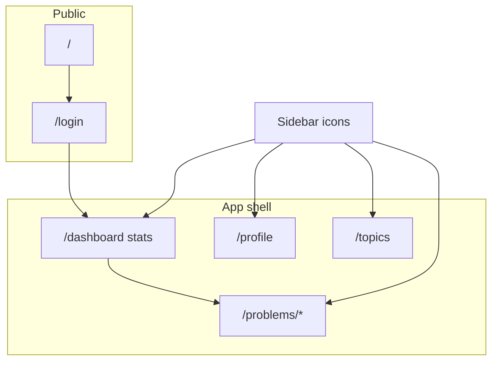

# UI/UX pivot — authenticated app shell (dashboard + sidebar)

**Status:** planned (post–MVP). **Scope:** frontend product chrome and navigation; no new backend capabilities unless routing or auth return URLs need adjustment.

**Context:** Core tracker behavior is implemented (Phase 8). The palette is in good shape; the pivot is **information architecture and navigation**: product areas move out of the global top navbar into an **app shell** with a **sidebar**, a **stats-first dashboard home**, a **separate profile page**, and **inline SVG icons** (one file per icon, shared folder + barrel).

**References:** [UI_UX_PIVOT_EXECUTION_PLAN.md](UI_UX_PIVOT_EXECUTION_PLAN.md) (phased work), [FRONTEND_CONVENTIONS.md](../../solve-tracker-frontend/FRONTEND_CONVENTIONS.md), [REQUIREMENTS.md](../REQUIREMENTS.md), [PHASE_8_RESULTS.md](PHASE_8_RESULTS.md).

---

## 1. Problem statement (current state)

| Area | Today | User impact |
| --- | --- | --- |
| Global nav | [`AuthNav.tsx`](../../solve-tracker-frontend/src/components/auth/AuthNav.tsx) puts **Library**, **Topics**, **Account** in the top bar. | Reads like a marketing site, not a workspace. |
| Signed-in home | [`index.tsx`](../../solve-tracker-frontend/src/routes/index.tsx) redirects to `/app` (stats). | — |
| Account | [`/account`](../../solve-tracker-frontend/src/routes/account.tsx) mixes “your session” with being a **nav destination** named like product sections. | Profile/settings should be distinct from **Dashboard (stats)**. |

**Requirements (user):**

- No product section links in the global top navbar.
- **Dashboard** area: **`/app` = stats only** (workspace root).
- **Profile** is a **separate page**, not the dashboard root.
- Sidebar uses **icons**; SVGs live in **one icons folder**, **one icon per file**, **barrel export**.

---

## 2. Goals and non-goals

### Goals

1. Public shell vs authenticated **app shell** (sidebar + main).
2. **Sidebar** with icon + label nav; active route via `aria-current="page"`.
3. **`/app`** reserved for **statistics / progress overview** (no profile form, no full library).
4. **`/app/profile`** for identity and session actions (evolves from `/account`).
5. **Icon system:** `src/icons/*.tsx` + `src/icons/index.ts` barrel; custom SVG only (no external icon npm package).
6. Product routes live under **`/app/*`**; redirect **`/account` → `/app/profile`** for bookmarks.

### Non-goals

- New backend endpoints for stats (reuse `GET /progress` and existing list meta).
- Library row / browse redesign (follow-on).
- Dark mode.

---

## 3. Route map — sidebar and app

### 3.1 Public routes (no sidebar)

| Path | Purpose |
| --- | --- |
| `/` | Guest landing; authenticated → redirect `/app` |
| `/login` | Sign in |
| `/register` | Register |
| `/forgot-password` | Request reset |
| `/reset-password` | Complete reset |

### 3.2 App shell routes (sidebar visible)

All routes below share **`routes/app.tsx`** layout (`RequireSession` + `AppShell`). `RequireSession` applies to the layout.

#### Sidebar — primary navigation

| Sidebar label | Path | Active when | Icon component | Purpose |
| --- | --- | --- | --- | --- |
| **Dashboard** | `/app` | path is `/app` | `IconDashboard` | **Stats only** — overall progress, solved/unsolved totals, optional per-topic summary cards, quick links as secondary actions |
| **Library** | `/app/problems` | path starts with `/app/problems` | `IconLibrary` | List, filters, pagination |
| **Topics** | `/app/topics` | path starts with `/app/topics` | `IconTopics` | Topic CRUD + topic progress |
| **Profile** | `/app/profile` | path starts with `/app/profile` | `IconUser` | Name, email, sign out, retry logout (replaces `/account` UX) |

#### Sidebar — primary action (not a “section”)

| Control | Path | Icon | Notes |
| --- | --- | --- | --- |
| **Add problem** | `/app/problems/new` | `IconPlus` | Primary `Button` or nav row; active when on `/app/problems/new` |

#### Sidebar — footer (action, not a page)

| Control | Behavior | Icon |
| --- | --- | --- |
| **Sign out** | Calls `auth.logout()`; no route | `IconLogOut` |

#### Shell chrome (mobile)

| Control | Behavior | Icon |
| --- | --- | --- |
| Open menu | Opens drawer | `IconMenu` |
| Close drawer | Closes drawer | `IconClose` |

#### Nested product routes (Library active; not separate sidebar items)

| Path | Sidebar highlight |
| --- | --- |
| `/app/problems` | Library |
| `/app/problems/new` | Library (+ Add problem CTA active) |
| `/app/problems/:id` | Library |
| `/app/problems/:id/edit` | Library |
| `/app/problems?topicId=…` | Library |

#### Compatibility redirect

| Old path | New path |
| --- | --- |
| `/account` | **`/app/profile`** (client `navigate` replace on load) |

### 3.3 Route tree (target filesystem)

```
routes/
  index.tsx                    # public home
  login.tsx, register.tsx, …   # auth (no sidebar)
  app.tsx                      # App shell layout: sidebar + outlet + RequireSession
  app/
    index.tsx                  # GET /app — STATS ONLY
    profile.tsx                # GET /app/profile
  app/problems.tsx             # layout: main padding only (nested under shell)
  app/problems/
    index.tsx, new.tsx, [id].tsx, [id]/edit.tsx
  app/topics.tsx
  topics/index.tsx
  account.tsx                    # optional: re-export redirect → profile, or delete after redirect route
```

**Note:** Solid file routing may implement the shell either as `dashboard.tsx` wrapping sibling segments via a parent `app.tsx`, or by importing `AppShell` into `problems.tsx`, `topics.tsx`, `dashboard/index.tsx`, and `profile.tsx`. Prefer **one layout parent** so sidebar mounts once.

### 3.4 Information architecture (diagram)



---

## 4. Dashboard (`/dashboard`) — stats page only

**FR-UX-04:** This route is **reserved for analytics-style overview**, not profile and not the full library.

### In scope on `/dashboard`

- **Overall progress** from `GET /progress` (`total`, `solved`, `unsolved`, optional `%`).
- **Per-topic stats** (compact list or cards): name, `solved/total`, percent — same data as topics index progress rows.
- **At-a-glance numbers** (tabular-nums); short headings (“Your practice”, “Overall”, “By topic”).
- **Secondary text links** (not duplicate sidebar): e.g. “Browse library”, “Manage topics” — optional if sidebar is always visible.

### Out of scope on `/dashboard`

- Edit name/email, sign out → **`/profile` only**.
- Browse toolbar, problem list, pagination.
- Create problem form (link/CTA ok; form lives on `/problems/new`).

### Empty / new user

- Zero problems: show progress zeros + copy pointing to **Add problem** and **Topics**.

### Loading / errors

- Match patterns from `LibraryProgressStrip` / topics progress (status text, retry).

**Important:** Search and filtering belong on **Library** (`/problems`), not on `/dashboard`. The dashboard may link to the library; it must not replace the browse experience.

---

## 5. Library (`/problems`) — search, filters, and list UX

**Requirement (user):** The problem list must offer **sufficient** search and filtering for daily use. This section defines what “sufficient” means for the UI/UX pivot, mapped to [FR-04](../REQUIREMENTS.md) and the existing implementation.

### 5.1 What already exists (keep and expose clearly)

| Capability | Backend / API | Frontend today |
| --- | --- | --- |
| Title / platform ID search | `q` (case-insensitive) | Search field in [`ProblemBrowseToolbar`](../../solve-tracker-frontend/src/components/problems/ProblemBrowseToolbar.tsx) |
| Status | `status=solved` \| `unsolved` | Status select |
| Platform | `platform=codeforces` \| `leetcode` \| `codechef` | Platform select |
| Topics (any match) | `topicIds` (repeatable) or legacy `topicId` | Topic checkboxes; `?topicId=` from Topics page |
| Untagged only | `untagged=true` (exclusive with topic filters) | Untagged checkbox |
| Sort / order | `sort`, `order` | Sort + order selects |
| Page size | `pageSize` 25 \| 50 \| 100 | Per-page select |
| Pagination | `page`, `meta.total` | Previous / next + “Page X · N results” |
| URL state | Query string | [`browse-query.ts`](../../solve-tracker-frontend/src/lib/problems/browse-query.ts) parse/serialize |
| Progress context | `GET /progress` | [`LibraryProgressStrip`](../../solve-tracker-frontend/src/components/problems/LibraryProgressStrip.tsx) — full library vs filtered count |

Pivot work must **not remove** any of the above. Regression: `browse-query.test.ts`, `verify:phase-7`, problems integration script.

### 5.2 “Sufficient” — functional bar (FR-04 + MVP §8)

The library page must allow a user to:

1. **Combine** title search, **status**, **platform**, and **topic** constraints in one applied query (API already ANDs filters when all are sent together).
2. **Combine** search + platform + unsolved in one action (MVP acceptance §8 criterion 8) — UI must send `q`, `platform`, and `status=unsolved` on the same request when the user applies filters.
3. **Filter by untagged** without topic selections.
4. **Enter from a topic** (`/problems?topicId=…`) and still refine with search/status/platform.
5. **See** how many rows match **filters** vs **whole library** (progress strip + “Showing N matching results”).
6. **Recover** from empty filter results (clear filters / clear href).
7. **Paginate** without loading the full library.

### 5.3 UX improvements required in the pivot (library page)

These are in scope for the pivot alongside the app shell — the library is the **primary working surface**.

| Area | Target UX |
| --- | --- |
| **Filter layout** | **Primary row:** Search, Status, Platform, **Apply** (or apply-on-change for selects with debounced search). **Secondary (“More filters”):** topics checkboxes, untagged, sort, order, page size — collapsible on mobile and desktop to reduce first-screen noise. |
| **Active filters** | Chip strip or summary line under the toolbar: “Search: … · Unsolved · LeetCode · 2 topics” with **Clear all** (reuse `browseClearHref()`). |
| **Apply model** | Either keep explicit **Apply filters** with validation, **or** auto-apply on select change + **debounced** search (300–400ms) — pick one and document; avoid forcing Apply for status/platform while search debounces. |
| **Topic entry** | When `?topicId=` is present, show a **banner** (existing) plus include that topic in active-filter summary; allow adding more topics in “More filters”. |
| **Toolbar placement** | Sticky optional below shell header on scroll (`z-10`) so filters stay reachable on long lists. |
| **List + shell** | Inside app shell, full content width for list; do not shrink filter panel below usable width on `md+`. |
| **Empty / error** | Keep distinct copy: new library vs no matches vs API error; always offer **Clear filters** when filters active. |

### 5.4 Out of scope for library browse (defer)

- Full-text search in notes, regex, saved filter presets, global spotlight search.
- Platform auto-detect beyond seeded slugs (unknown URLs still show hostname label).
- Topic typeahead with search across 100+ topics (improvement after collapsible filters + cap note remains).

### 5.5 Implementation notes

| Task | Detail |
| --- | --- |
| Combined filter API | Add or extend integration assertion: single GET with `q` + `platform` + `status=unsolved` (gap noted in Phase 8 acceptance). |
| `hasActiveBrowseFilters` | Extend if chip strip needs to ignore default sort/page only. |
| Icons | Optional `IconSearch`, `IconFilter`, `IconX` in `src/icons/` for toolbar/chips when shell ships. |
| Tests | Extend `browse-query.test.ts` for combined serialize/parse; component test for chip labels if extracted. |

### 5.6 Library acceptance criteria (browse)

1. User can apply **search + unsolved + LeetCode** in one operation and see only matching rows (or empty state).
2. User can combine **topic filter** (from URL or checkboxes) with **status** and **search**.
3. Active constraints are **visible** without reopening the filter form (summary or chips).
4. **Clear filters** resets to full library; progress strip totals unchanged, matching count resets.
5. Pagination works with every filter combination; URL is shareable/bookmarkable.
6. All FR-04 filter dimensions in §5.1 remain available after shell migration.

---

## 6. Profile (`/profile`) — separate from dashboard

**FR-UX-07:** Profile is a **dedicated route**, not a tab on the stats page.

### Content (migrate from [`account.tsx`](../../solve-tracker-frontend/src/routes/account.tsx))

- Display **name** and **email** (read-only for MVP).
- **Sign out** button (+ pending state, revocation retry messaging).
- Page title: **Profile** (not “Account” in nav — sidebar label **Profile**).

### Layout

- Inside app shell (sidebar visible).
- Drop standalone [`AuthLayout`](../../solve-tracker-frontend/src/components/auth/AuthLayout.tsx) wrapper for this page; use shell main + `Panel` if needed.

### Post-login default

- Still **`/dashboard`** when no `next=` query (stats home, not profile).

---

## 7. Icon system

### 7.1 Requirements

- **No third-party icon package** for sidebar v1.
- Each icon is a **small Solid component** rendering **inline SVG** (stroke style, consistent 24×24 viewBox, `currentColor` for `stroke`/`fill` so `text-brand` / `text-muted` on parent works).
- **One icon per file** under **`solve-tracker-frontend/src/icons/`**.
- **Barrel:** `solve-tracker-frontend/src/icons/index.ts` re-exports all icons.
- Decorative icons in nav: **`aria-hidden="true"`** when paired with visible text; icon-only controls need **`aria-label`**.

### 7.2 File naming

| File | Export | Used for |
| --- | --- | --- |
| `IconDashboard.tsx` | `IconDashboard` | Sidebar Dashboard |
| `IconLibrary.tsx` | `IconLibrary` | Sidebar Library |
| `IconTopics.tsx` | `IconTopics` | Sidebar Topics |
| `IconPlus.tsx` | `IconPlus` | Add problem |
| `IconUser.tsx` | `IconUser` | Sidebar Profile |
| `IconLogOut.tsx` | `IconLogOut` | Sign out control |
| `IconMenu.tsx` | `IconMenu` | Mobile open |
| `IconClose.tsx` | `IconClose` | Mobile close |

Add new icons only as new files + one line in `index.ts` (do not combine multiple icons in one file).

### 7.3 Component contract (sketch)

```tsx
// solve-tracker-frontend/src/icons/IconLibrary.tsx
import type { JSX } from "solid-js";

export function IconLibrary(props: { class?: string }): JSX.Element {
  return (
    <svg
      class={props.class}
      xmlns="http://www.w3.org/2000/svg"
      width="24"
      height="24"
      viewBox="0 0 24 24"
      fill="none"
      stroke="currentColor"
      stroke-width="2"
      stroke-linecap="round"
      stroke-linejoin="round"
      aria-hidden="true"
    >
      {/* path(s) — generated at implementation time */}
    </svg>
  );
}
```

```ts
// solve-tracker-frontend/src/icons/index.ts
export { IconDashboard } from "./IconDashboard";
export { IconLibrary } from "./IconLibrary";
// …
```

### 7.4 Sidebar row pattern

- 44px min height row: icon (20–24px) + label; active state on row (`brand-soft` background).
- Import icons from `../../icons` (barrel).

---

## 8. Functional requirements (consolidated)

| ID | Requirement |
| --- | --- |
| FR-UX-01 | Guest top bar: brand + sign in / register only. |
| FR-UX-02 | Authenticated routes use app shell: sidebar + `#main-content`. |
| FR-UX-03 | Sidebar items per §3.2 with icons and `aria-current`. |
| FR-UX-04 | `/dashboard` = stats only (§4). |
| FR-UX-05 | `/profile` separate from dashboard (§5). |
| FR-UX-06 | Deep links and `next=` preserved; default post-auth `/dashboard`. |
| FR-UX-08 | Icons per §6; implement SVGs when building sidebar (not necessarily in doc-only phase). |
| FR-UX-09 | `/account` redirects to `/profile`. |
| FR-UX-10 | Library search/filter meets §5.2–5.6; full browse stays on `/problems`. |

---

## 9. UX — shell and navigation

- **Global top bar:** brand (+ mobile menu trigger inside shell header); **no** Library/Topics/Account links.
- **Dashboard vs Profile:** user always knows stats live at **Dashboard**, identity/session at **Profile**.
- **Icons + labels** aid scan; labels remain for accessibility (not icon-only primary nav except menu on small screens with labels in drawer).
- **Logo** when signed in → `/dashboard` (stats home).
- Mobile: drawer per prior spec; icons remain beside labels.

---

## 10. Implementation checklist

### Shell & routes

- [ ] App shell layout (`AppShell`, `AppSidebar`) with icon nav from §3.2.
- [ ] `routes/dashboard/index.tsx` — stats page.
- [ ] `routes/profile.tsx` — profile page; migrate account content.
- [ ] Redirect `/account` → `/profile`.
- [ ] Wrap `problems/*`, `topics/*` under same shell.
- [ ] Slim guest `AuthNav`; remove signed-in product links.

### Icons

- [ ] Create `solve-tracker-frontend/src/icons/` + eight icon files + `index.ts`.
- [ ] Wire icons into sidebar and mobile chrome.

### Dashboard stats

- [ ] `createProgressApi` on dashboard; topic summaries.
- [ ] No profile fields on dashboard.

### Auth flows

- [ ] `/` → `/dashboard` when authenticated.
- [ ] Login/register default landing `/dashboard`.

### Library browse (§5)

- [ ] Tiered toolbar: primary filters + collapsible “More filters”.
- [ ] Active filter summary or chips + clear all.
- [ ] Combined `q` + `platform` + `status` verified in UI and integration test.
- [ ] Sticky toolbar optional pass; empty/error states preserved in shell.

### Quality

- [ ] `nav-active.ts` helper tests (prefix rules §3.2).
- [ ] `pnpm exec tsc`, `lint`, `test --run` in `solve-tracker-frontend`.
- [ ] Update `FRONTEND_CONVENTIONS.md` (shell + icons).

---

## 11. Acceptance criteria

1. Sidebar routes match §3.2; each primary item has its icon from `src/icons/`.
2. `/dashboard` shows stats only; profile/sign-out not on that page.
3. `/profile` holds session/identity actions formerly on `/account`.
4. No Library/Topics/Profile in global top nav when signed in.
5. `/account` resolves to profile experience.
6. One icon per file + barrel export enforced.
7. Library browse meets §5.6 (combined filters, visible active constraints, URL state).

---

## 12. Follow-on UX (after shell)

Library **row** simplification (actions, badges, chips), problem **detail** action bar, loading skeletons — browse/filter requirements are §5, not deferred.

---

## 13. Summary

| Item | Decision |
| --- | --- |
| Stats home | **`/dashboard`** (`dashboard/index.tsx`) |
| Profile | **`/profile`** (separate from dashboard) |
| Legacy account URL | Redirect **`/account` → `/profile`** |
| Sidebar routes | Dashboard, Library, Topics, Profile + Add problem CTA + Sign out |
| Icons | **`src/icons/`**, one SVG component per file, **`index.ts` barrel** |
| Problem list | **Full search/filter on `/problems`** (§5); dashboard = stats only |

**Next implementation step:** App shell + icons + dashboard + profile; then library toolbar tiers, active filter chips, and combined-filter verification.