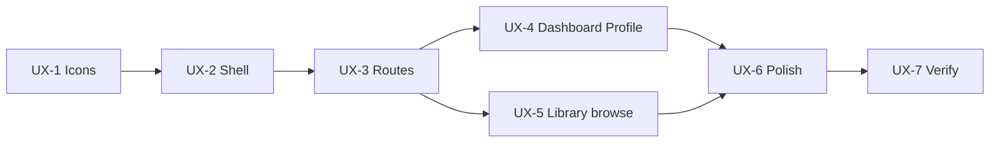

# UI/UX pivot — phased execution plan

**Status:** not started. **Design reference:** [UI_UX_PIVOT.md](UI_UX_PIVOT.md). **Prerequisites:** Phase 8 complete (`pnpm verify:phase-8`); `solve-tracker-frontend` builds and tests green.

**Outcome:** Signed-in users work inside an **app shell** (sidebar + icons), land on **`/app` (stats)**, manage identity on **`/app/profile`**, and use **`/app/problems`** with **sufficient** search/filter UX. Global top nav no longer lists product sections.

**Scope:** `solve-tracker-frontend` only unless a redirect or `next=` default requires a one-line auth helper change. **No** new backend features.

---

## 1. Phase overview

| Phase | Name | Depends on | Delivers |
| --- | --- | --- | --- |
| **UX-1** | Icons & navigation primitives | — | `src/icons/`, `nav-active` helper, tests |
| **UX-2** | App shell layout | UX-1 | `AppShell`, `AppSidebar`, mobile drawer shell |
| **UX-3** | Routes, guest chrome, redirects | UX-2 | Shell wraps product routes; `/account` → `/profile` |
| **UX-4** | Dashboard & profile pages | UX-3 | `/dashboard` stats; `/profile`; auth landing |
| **UX-5** | Library browse UX | UX-3 | Tiered filters, active chips, combined-filter proof |
| **UX-6** | Polish & list/detail UX | UX-4, UX-5 | Sticky toolbar, row actions, badges (optional scope) |
| **UX-7** | Verification & handoff | UX-1–6 | Docs, results file, regression gates |

Recommended order: **UX-1 → UX-2 → UX-3 → UX-4** in sequence; **UX-5** can overlap UX-4 once UX-3 merges; **UX-6** last optional tranche; **UX-7** closes the pivot.



---

## UX-1 — Icons and navigation primitives

**Status (2026-11-15):** Done — icons barrel, `nav-active`, unit tests; no route/shell changes.

### Work

- Create [`solve-tracker-frontend/src/icons/`](../../solve-tracker-frontend/src/icons/) with **one SVG component per file** and [`index.ts`](../../solve-tracker-frontend/src/icons/index.ts) barrel (see UI_UX_PIVOT §7.2):
  - `IconDashboard`, `IconLibrary`, `IconTopics`, `IconPlus`, `IconUser`, `IconLogOut`, `IconMenu`, `IconClose`
- Optional for UX-5: `IconSearch`, `IconFilter`, `IconX` (chips/clear).
- Add [`solve-tracker-frontend/src/lib/app/nav-active.ts`](../../solve-tracker-frontend/src/lib/app/nav-active.ts) (or similar): given `pathname` + `search`, return active sidebar key (`dashboard` \| `library` \| `topics` \| `profile` \| `add-problem`) per UI_UX_PIVOT §3.2.
- Unit tests for `nav-active` (nested `/problems/:id`, `/problems/new`, exact `/dashboard`).

### Exit criteria

- All sidebar icons importable from `../../icons`.
- `nav-active` tests pass; no route components changed yet.

### Verification

```bash
cd solve-tracker-frontend && pnpm exec tsc --noEmit && pnpm test --run
```

---

## UX-2 — App shell layout

**Status (2026-11-16):** Done — `AppShell`, `AppSidebar`, mobile drawer, tests; routes not wired (UX-3).

### Work

- Implement [`AppShell.tsx`](../../solve-tracker-frontend/src/components/app/AppShell.tsx): flex layout, sidebar column + main (`#main-content`), skip-link target preserved.
- Implement [`AppSidebar.tsx`](../../solve-tracker-frontend/src/components/app/AppSidebar.tsx): nav rows with icon + label; footer sign out; **Add problem** CTA; wire `nav-active` + `aria-current="page"`.
- Mobile: header with `IconMenu`; drawer overlay (focus trap, Escape, close on navigate) — can be minimal in UX-2, hardened in UX-6.
- **Do not** mount shell on login/register/forgot/reset/guest `/` yet (UX-3).

### Exit criteria

- Storybook-style manual check: render `AppShell` in isolation with placeholder outlet **or** temporary route spike documented in PR.
- Sidebar meets 44px row height and focus-visible per FRONTEND_CONVENTIONS.

### Verification

Frontend unit tests if shell logic extracted; manual smoke in dev.

---

## UX-3 — Routing and public chrome

**Status (2026-11-16):** Done — `(app)` layout + shell on product routes, guest chrome, `/account` → `/profile`, placeholders.

### Work

- Introduce layout route [`routes/dashboard.tsx`](../../solve-tracker-frontend/src/routes/dashboard.tsx) (app workspace layout: `RequireSession` + `AppShell` + `<Outlet>`).
- Nest under shell (adjust file tree per Solid router — see UI_UX_PIVOT §3.3):
  - `dashboard/index.tsx` (placeholder OK until UX-4)
  - `profile.tsx` (placeholder OK until UX-4)
  - Move shell wrapper from duplicate `problems.tsx` / `topics.tsx` `<main>` into shared parent **or** import `AppShell` once in a new parent `app.tsx` if cleaner.
- [`App.tsx`](../../solve-tracker-frontend/src/App.tsx): global nav **guest-only** links (`AuthNav` sign in/register); remove authenticated Library/Topics/Account from top bar.
- [`AuthNav.tsx`](../../solve-tracker-frontend/src/components/auth/AuthNav.tsx): authenticated branch removed from global header.
- Add [`routes/account.tsx`](../../solve-tracker-frontend/src/routes/account.tsx) redirect → `/profile` (or thin re-export).
- Ensure deep links: `/problems?topicId=`, `next=` on login unchanged.

### Exit criteria

- Signed-in user sees **sidebar on** `/problems`, `/topics`, `/dashboard`, `/profile` (pages may be placeholders).
- Guest routes have **no** sidebar.
- `/account` navigates to profile experience.

### Verification

```bash
cd solve-tracker-frontend && pnpm exec tsc --noEmit && pnpm lint && pnpm test --run
cd ../solve-tracker-backend && TEST_DATABASE_URL=.../_test pnpm verify:phase-8
```

---

## UX-4 — Dashboard (stats) and profile

**Status (2026-11-16):** Done — dashboard stats, profile page, auth landing `/dashboard`.

### Work

- **`/dashboard`** ([`routes/dashboard/index.tsx`](../../solve-tracker-frontend/src/routes/dashboard/index.tsx)):
  - `GET /progress` overall + per-topic summaries (FR-UX-04).
  - No profile fields, no browse toolbar, no problem list.
  - Loading/error/empty states.
- **`/profile`** ([`routes/profile.tsx`](../../solve-tracker-frontend/src/routes/profile.tsx)):
  - Migrate content from [`account.tsx`](../../solve-tracker-frontend/src/routes/account.tsx); drop `AuthLayout` wrapper; keep sign out + revocation UX.
- **[`index.tsx`](../../solve-tracker-frontend/src/routes/index.tsx):** authenticated redirect **`/dashboard`** (not `/problems`).
- **Auth flows:** default post-login/register destination `/dashboard` when no `next` ([`guest-auth-page.ts`](../../solve-tracker-frontend/src/lib/auth/guest-auth-page.ts), login/register as needed).
- Logo in shell → `/dashboard`.

### Exit criteria

- UI_UX_PIVOT §4 and §6 acceptance: stats-only dashboard; profile separate.
- Manual: register → dashboard; sign out from profile or sidebar.

### Verification

Same as UX-3; no backend changes required.

---

## UX-5 — Library search and filters

**Status (2026-11-16):** Done — tiered toolbar, active filter chips, combined-filter tests.

### Work

- Refactor [`ProblemBrowseToolbar.tsx`](../../solve-tracker-frontend/src/components/problems/ProblemBrowseToolbar.tsx) per UI_UX_PIVOT §5.3:
  - **Primary:** search, status, platform, apply (or debounced search + auto-apply on selects — document choice in component).
  - **Collapsible “More filters”:** topics, untagged, sort, order, page size.
- Add **active filter summary** or chips + clear all (use `hasActiveBrowseFilters` / serialize helpers).
- Preserve URL sync via [`browse-query.ts`](../../solve-tracker-frontend/src/lib/problems/browse-query.ts); extend tests for combined `q` + `platform` + `status`.
- **Backend (minimal):** one integration assertion in [`test-problems-integration.mjs`](../scripts/test-problems-integration.mjs) for combined GET (Phase 8 gap).
- Confirm `LibraryProgressStrip` still correct inside shell.

### Exit criteria

- UI_UX_PIVOT §5.6 (all seven browse acceptance bullets).
- `browse-query.test.ts` updated; `verify:phase-7` or problems integration passes.

### Verification

```bash
cd solve-tracker-backend && TEST_DATABASE_URL=.../_test pnpm test:problems:integration
cd ../solve-tracker-frontend && pnpm test --run
```

---

## UX-6 — Polish (optional but recommended)

**Status (2026-11-16):** Done — drawer Tab trap + body scroll lock; `LoadingPlaceholder`; sticky browse chrome; `ProblemLibraryRow`; detail `Panel` actions; unit tests.

### Work

- Mobile drawer hardening (focus trap, backdrop, `prefers-reduced-motion`).
- Optional **sticky** browse toolbar on `/problems`.
- **Library list rows** (UI_UX_PIVOT §12 follow-on):
  - Reduce actions (primary: Open + Mark solved; secondary menu for edit/delete).
  - Status `Badge`; topic chips.
- **Problem detail** top action bar (Open + completion).
- Loading skeletons for dashboard stats and problem list (lightweight).

### Exit criteria

- No P0 a11y regressions on narrow viewport.
- List row actions ≤3 visible primary controls without hover-only discovery.

### Verification

Manual checklist in results doc; frontend tests updated for changed components.

---

## UX-7 — Verification and documentation

### Work

- Create [`UI_UX_PIVOT_RESULTS.md`](UI_UX_PIVOT_RESULTS.md): phases completed, manual checklist, known limits.
- Update [`FRONTEND_CONVENTIONS.md`](../../solve-tracker-frontend/FRONTEND_CONVENTIONS.md): app shell, icons folder, sidebar routes.
- Update [`PROJECT_EXECUTION_PLAN.md`](../PROJECT_EXECUTION_PLAN.md) UI/UX pivot status → complete.
- Update [`UI_UX_PIVOT.md`](UI_UX_PIVOT.md) status line.
- Optional: [`solve-tracker-frontend/scripts/verify-ux-pivot.mjs`](../../solve-tracker-frontend/scripts/verify-ux-pivot.mjs) — tsc, lint, test, grep for `AuthNav` authenticated product links absence, `src/icons/index.ts` exists.

### Exit criteria

- UI_UX_PIVOT §11 acceptance criteria (all seven) signed off in RESULTS.
- `pnpm verify:phase-8` still passes (no backend regression).

### Suggested one-shot gate

```bash
cd solve-tracker-frontend && pnpm exec tsc --noEmit && pnpm lint && pnpm test --run && pnpm build
cd ../solve-tracker-backend && TEST_DATABASE_URL=.../practice_tracker_test pnpm verify:phase-8
```

---

## 2. Completion checklist

- [x] UX-1 Icons & `nav-active`
- [x] UX-2 App shell components
- [x] UX-3 Routes + guest chrome + `/account` redirect
- [x] UX-4 Dashboard stats + profile + auth landing
- [x] UX-5 Library browse tiers + chips + combined filter
- [x] UX-6 Polish (mobile, list rows, detail bar) — optional
- [ ] UX-7 RESULTS + conventions + execution plan status

---

## 3. Risks and mitigations

| Risk | Mitigation |
| --- | --- |
| Solid file-route nesting surprises | Spike UX-3 early; one parent layout file |
| Duplicate `<main>` padding | Shell owns padding; remove from child layouts |
| Filter regression | URL round-trip tests + integration combined GET |
| Login `next=` breaks | Explicit test for `?next=/problems?topicId=` |
| Icon maintenance | Strict one-file-one-icon + barrel |

---

## 4. Relationship to MVP phases

| MVP phase | UX pivot |
| --- | --- |
| Phase 8 | Regression baseline; run after UX-3+ |
| Phase 9 | Unaffected (production env); shell is product UX only |
| Deferred features | CSV, sharing, etc. — not in UX phases |

---

## 5. Summary

Execute **seven phased steps** (UX-1 through UX-7). Minimum viable pivot: **UX-1 → UX-5 + UX-7**; **UX-6** improves list/detail density after shell and browse are stable.

**Start with:** UX-1 (icons + `nav-active`), then UX-2 (shell components).