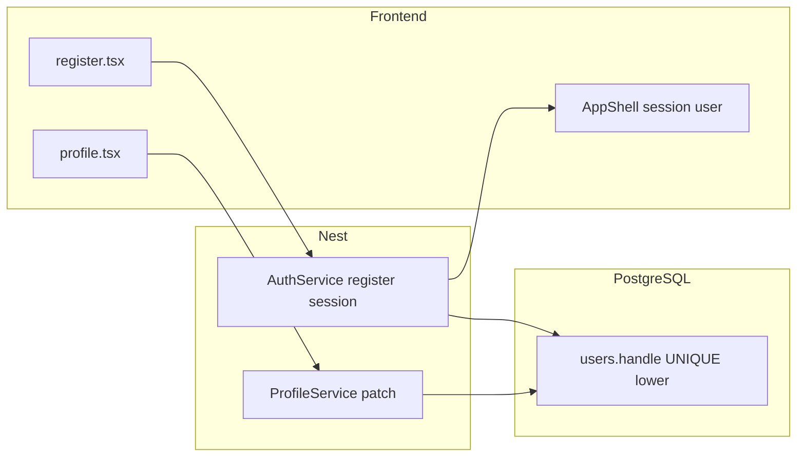
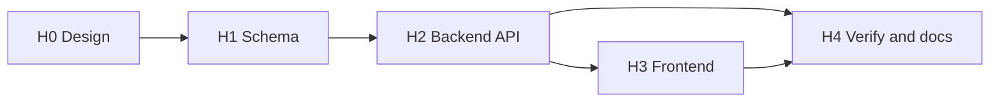

# User handle (Codeforces-style username) — phased execution plan

**Status:** H1 complete (2026-11-18). **H0:** [USER_HANDLE_A0_RESULTS.md](USER_HANDLE_A0_RESULTS.md). **H1:** [USER_HANDLE_H1_RESULTS.md](USER_HANDLE_H1_RESULTS.md).  
**Codename:** `USER-HANDLE` (phases **H0–H4** below).  
**Problem:** Identity today is **display name** + **email** only ([`users` table](../src/database/schema/users/users.table.ts), [REQUIREMENTS.md](../REQUIREMENTS.md) FR-07). Email is private and unsuitable as a public label; display name is not unique and not stable. Users want a **unique handle** (e.g. `tourist`, `Benq`) like Codeforces — for profile identity, future sharing, and consistent `@mention`-style display.  
**Outcome:** Optional-at-first, **globally unique**, **case-insensitive** handle on `users`, set at registration or profile, exposed in session + profile API, edited under clear rules. **Login stays email-based**; handles are not credentials in MVP.

**References:** [REQUIREMENTS.md](../REQUIREMENTS.md), [GOOGLE_OAUTH_RESULTS.md](GOOGLE_OAUTH_RESULTS.md), [AUTH_CONVENTIONS.md](../../solve-tracker-frontend/AUTH_CONVENTIONS.md), [FRONTEND_CONVENTIONS.md](../../solve-tracker-frontend/FRONTEND_CONVENTIONS.md), [PROJECT_EXECUTION_PLAN.md](../PROJECT_EXECUTION_PLAN.md).

---

## 1. Scope, prerequisites, boundaries

### Prerequisites

- Phase 4 auth and profile modules stable (`GET/PATCH /profile`, `GET /auth/session`, register/login).
- Google OAuth (G0–G7) shipped — handle policy must cover Google-only and linked accounts.
- OpenAPI / `pnpm api:check` workflow in use on both backend and frontend.

### In scope (MVP)

| Area | Deliverable |
| --- | --- |
| **Data** | `users.handle` — nullable during rollout, unique (case-insensitive) |
| **Validation** | Shared Zod schema; reserved words; conflict + field errors |
| **Registration** | Optional handle on email/password register |
| **Profile** | Set / change handle via `PATCH /profile` (with change policy) |
| **Session** | `handle` on `user` in login/register/session/refresh responses when set |
| **Google new users** | Handle remains unset until user claims one (no auto-random handle in product UI) |
| **Existing users** | `NULL` handle allowed; profile prompt to claim (no forced migration) |
| **Frontend** | Register (optional), profile editor, shell/profile display `@handle`, missing-handle hint |
| **Verification** | Integration tests (uniqueness, concurrent create, case fold), docs + RESULTS rollup |

### Out of scope (defer unless product requests)

| Item | Notes |
| --- | --- |
| Login with handle instead of email | Email (+ Google) remains primary credential |
| Public profile by URL `/u/:handle` or API `GET /users/:handle` | Vanity in authenticated app only for MVP |
| Leaderboards, follows, mentions, DMs | Handle is identity groundwork only |
| Handle history / redirects after rename | Only current handle stored |
| Enterprise SSO username mapping | N/A |
| Moderation queue for offensive handles | Start with blocklist + report-later; no admin UI in MVP |

### Non-goals (architecture)

- No second user table or `profiles` split — handle lives on `users` next to `name`.
- No change to `AccessGuard`, owner scoping, or JWT purpose claims (handle is profile data, not authorization).
- No breaking change to email uniqueness or session revocation semantics.

---

## 2. Policy (H0 — lock before coding)

### 2.1 Fields compared

| Field | Role | Unique? | Login? |
| --- | --- | --- | --- |
| **email** | Credential + recovery | Yes (normalized lower) | Yes |
| **name** | Display name (“Shafayet Ahmed”) | No | No |
| **handle** | Public stable id (`shafayet_cp`) | Yes (case-insensitive) | No (MVP) |

Store handle **canonical lowercase** in PostgreSQL; display with preserved user casing optional later (MVP: store lowercase, show as typed on set once).

### 2.2 Format rules (recommended default — change only in H0 sign-off)

| Rule | Value |
| --- | --- |
| Length | 3–24 characters (Unicode code points) |
| Charset | ASCII letters, digits, underscore `[a-zA-Z0-9_]` |
| Start / end | Letter or digit (not `_`) |
| Case | Case-insensitive uniqueness; persist `lower()` |
| Display | UI may show `@handle` prefix; API returns bare `handle` string |
| Trim | Reject leading/trailing whitespace; no interior spaces |

**Reserved handles (minimum):** `admin`, `api`, `app`, `auth`, `help`, `login`, `logout`, `me`, `null`, `profile`, `register`, `root`, `settings`, `support`, `www`, `practice`, plus route segments used in frontend (`problems`, `topics`, `dashboard`). Maintain as server-side set + test.

### 2.3 When users set a handle

| Path | Policy |
| --- | --- |
| Email register | **Optional** handle field; omit → `NULL` |
| Google register / first login | `NULL` until user sets in profile (or optional future onboarding step) |
| Existing DB users | Remain `NULL`; soft prompt in profile / dashboard |
| Required gate | **No** hard gate on library CRUD for MVP (avoid bricking existing installs) |

### 2.4 Change policy (recommended)

- User may **change** handle after set: **at most once per 30 days** (store `handle_changed_at` or reuse `updated_at` only if insufficient — prefer dedicated column).
- First-time set: no cooldown.
- **Unset → set:** always allowed.
- Alternative (stricter): one change ever — only pick if product explicitly wants Codeforces-like permanence.

### 2.5 Uniqueness & concurrency

- DB: **unique index** on `lower(handle)` where `handle is not null` (partial unique index).
- App: catch `23505` → `HANDLE_IN_USE` (409) with field key `handle`.
- Register + patch in **transaction**; no pre-check without insert (TOCTOU-safe).

### 2.6 Privacy & abuse

- Handle is **public within the authenticated product** (session, profile, future social).
- Do not expose handles in password-reset or forgot-password responses.
- Rate-limit handle availability checks and patch attempts (reuse auth/profile rate-limit patterns).

### 2.7 REQUIREMENTS.md

- Amend **FR-07**: registration remains name + email + password; **optional fourth field `handle`**.
- Add **FR-08** (or profile FR): unique handle rules, change policy, not a login identifier in MVP.

**H0 exit:** `USER_HANDLE_A0_RESULTS.md` with signed-off table above + reserved list + error code names.

---

## 3. Architecture

| Surface | Change |
| --- | --- |
| `POST /auth/register` | Optional `handle` |
| `GET /auth/session`, login, refresh | `user.handle` optional string |
| `GET /profile` | `handle` in body |
| `PATCH /profile` | `handle` in patch body |
| Optional `GET /profile/handle-availability?handle=` | 200 `{ available: boolean }` — rate limited; **not required** if PATCH-only UX is enough |

No new module required — extend `users` schema, `AuthService`, `ProfileService`, shared `user-handle.schema.ts`.

---

## 4. Phases

### H0 — Design lock & requirements ✅

| Deliverable | Detail |
| --- | --- |
| `docs/USER_HANDLE_A0_RESULTS.md` | Policy §2 frozen; reserved list; error codes; 30-day change cooldown |
| `REQUIREMENTS.md` | FR-07 bullet + addendum USER-HANDLE; acceptance criterion #21 |
| Decision log | Login-with-handle: **deferred**; public URL: **deferred** |

**Results:** [USER_HANDLE_A0_RESULTS.md](USER_HANDLE_A0_RESULTS.md). **Exit:** No migration SQL in H0.

---

### H1 — Schema, migration, shared validation ✅

| Deliverable | Detail |
| --- | --- |
| Migration | `users.handle` `text` **NULL**; `users.handle_changed_at` timestamptz NULL; partial unique index `unique (lower(handle)) where handle is not null` |
| Drizzle | `users.table.ts` + snapshot |
| `user-handle.schema.ts` | Zod: format, reserved, normalize to lower; export `profileHandleSchema`, type guards |
| Backfill | **None** for production users (NULL OK); integration tests use explicit handles |
| Rollback doc | Drop column + index in down migration |

**Results:** [USER_HANDLE_H1_RESULTS.md](USER_HANDLE_H1_RESULTS.md). **Verify:** `pnpm db:check`; `pnpm build`; `pnpm test`; `TEST_DATABASE_URL=…/_test pnpm test:user-handle:integration`; auth integration regression on `*_test`.

**Exit:** Empty app boots; existing rows unchanged; unique index enforced in DB tests.

---

### H2 — Backend API & auth integration

| Deliverable | Detail |
| --- | --- |
| **Register** | `registerSchema.handle` optional; `AuthService.register` sets handle when provided |
| **Profile** | `patchProfileSchema.handle`; cooldown enforcement; `HANDLE_*` errors in `profile.errors.ts` |
| **Responses** | `userSchema` / `profileResponseSchema` + `sessionResponseSchema` include `handle: z.string().optional()` or nullable |
| **safeUser** | Include `handle` when non-null |
| **Google paths** | New Google users: `handle` null; no silent auto-generation |
| **Repository** | `findByHandle(lower)` for future use optional; uniqueness via DB |
| **OpenAPI** | Regenerate `openapi.json`; `.env.openapi` unchanged |
| **Tests** | Service specs (cooldown, reserved, duplicate); `test:auth:integration` + new `test:profile-handle:integration` (or extend profile integration script) |

**Verify:** `pnpm test`; `TEST_DATABASE_URL=…/_test pnpm test:auth:integration`; profile handle integration green; `pnpm api:check`.

**Exit:** API clients can set/read handle; session carries handle; conflicts return field-aware 409.

---

### H3 — Frontend product UX

| Deliverable | Detail |
| --- | --- |
| **Types** | Generated / hand-maintained client types for `handle` on user + profile |
| **Register** | Optional handle with inline rules + server error mapping (`HANDLE_IN_USE` → field) |
| **Profile** | Handle field in account/about panel; change shows cooldown message from API |
| **Session** | `AuthProvider` / bootstrap: store `user.handle`; `establishSession` sync |
| **Chrome** | Profile header / shell: show `@handle` when set; omit when null |
| **Nudge** | Dismissible banner when authenticated and `handle` missing (link to profile) |
| **Google flow** | Post-link landing unchanged; nudge applies equally |
| **Copy** | Explain difference: name vs handle vs email (one short paragraph in profile) |
| **Tests** | Form validation unit tests; profile/register component tests as applicable |

**Verify:** `pnpm test` (frontend); manual: register with/without handle; patch conflict; Google user claims handle.

**Exit:** End-to-end happy path without public profile routes.

---

### H4 — Regression gate, ops, documentation

| Deliverable | Detail |
| --- | --- |
| `docs/USER_HANDLE_RESULTS.md` | Rollup, limitations, manual checklist |
| `docs/USER_HANDLE_H4_RESULTS.md` | Verification command table |
| Script (optional) | `verify-user-handle.mjs` — schema wiring, reserved list grep, vitest slice; or document under `verify:phase-*` only |
| `PRODUCTION.md` | Migration note: deploy migration before app; NULL handles OK |
| Cross-links | `README.md` profile section one line |

**Manual checklist**

- [ ] Register with unique handle → session shows handle.
- [ ] Register duplicate handle (case variant) → 409 field error.
- [ ] Existing user `NULL` → login OK; set handle in profile.
- [ ] Change handle within cooldown → rejected with clear message.
- [ ] Google-only user → claim handle in profile.
- [ ] `pnpm api:check` green on both packages.

**Exit:** `USER-HANDLE` closed for MVP; public-by-handle deferred explicitly.

---

## 5. Phase dependency graph

H3 and H4 backend portions can overlap after H2 API is stable (OpenAPI regenerated).

---

## 6. Risks and mitigations

| Risk | Mitigation |
| --- | --- |
| Mass `NULL` handles forever | Product nudge; later optional “complete profile” gate |
| Reserved list gaps | Route audit in H0; test asserts known routes blocked |
| Email/register overload | Handle optional; no extra required friction |
| Google name ≠ desired handle | User picks manually in profile |
| Concurrent duplicate | DB unique index + 409 mapping |
| FR-07 contradiction | Explicit requirements amendment in H0 |

---

## 7. Future (post–H4, not scheduled)

- `GET /users/by-handle/:handle` for public profile cards.
- Login alias: `handle OR email` (requires careful anti-enumeration).
- Handle search for friends/teams.
- Profanity filter / admin rename tool.

---

## 8. Relation to other work

| Feature | Interaction |
| --- | --- |
| Google OAuth | Same `users` row; handle independent of `auth_provider_identities` |
| Google RISC | No change |
| Topics / problems | No owner handle in API responses yet (user id only) |
| Media / avatar | Unchanged |

---

## 9. Suggested implementation order (single sprint view)

1. H0 doc + REQUIREMENTS tweak  
2. H1 migration + Zod  
3. H2 auth + profile + OpenAPI + integration tests  
4. H3 frontend  
5. H4 RESULTS + optional verify script  

Estimated **5 phases**, each meaningful alone; do not split H2 into per-endpoint micro-phases.