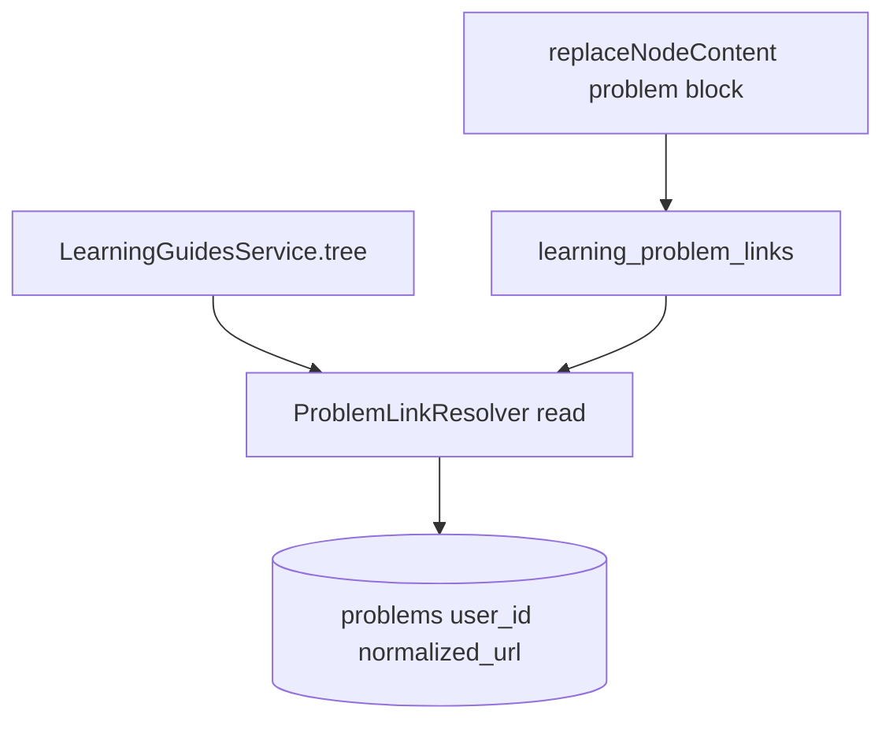

# Phase 5 — Problem tracker integration (slice plan)

**Branch:** `feature/learning-guides` (continued)  
**Prerequisite:** [LEARNING_4_PHASE_SIGNOFF.md](./LEARNING_4_PHASE_SIGNOFF.md)  
**Objective (roadmap):** Connect knowledge acquisition with deliberate coding practice without duplicating progress entry.

## Slice exit criteria

| Slice | Delivered | Signoff |
|-------|-----------|---------|
| **5.0** | Baseline + contract docs; API decisions; Phase 4 gates green | [LEARNING_5_0_RESULTS.md](./LEARNING_5_0_RESULTS.md) |
| **5A** | `problem` block type + `learning_problem_links`; author content replace; URL normalization | [LEARNING_5A_RESULTS.md](./LEARNING_5A_RESULTS.md) |
| **5B** | Learner resolution DTO (resolved / unresolved / solved); narrow Problems read contract | [LEARNING_5B_RESULTS.md](./LEARNING_5B_RESULTS.md) |
| **5C** | Add-to-library + study UI block; link to existing solve/mark-solved flows | [LEARNING_5C_RESULTS.md](./LEARNING_5C_RESULTS.md) |
| **5D** | Gated (and optional required-block) completion uses solved state for problem gates | [LEARNING_5D_RESULTS.md](./LEARNING_5D_RESULTS.md) |
| **5E** | Backlinks from problem detail → learning steps (owner-scoped) | [LEARNING_5E_RESULTS.md](./LEARNING_5E_RESULTS.md) |

**Phase exit criteria (roadmap):** A DSA-style guide can require reading, passing an assessment, and solving linked problems; one library record updates all linked steps; deleting a problem does not break the guide.

**5A blocked until:** [LEARNING_5_0_RESULTS.md](./LEARNING_5_0_RESULTS.md) (5.0 complete).

## Design authority

- [DATABASE_ARCHITECTURE.md](./DATABASE_ARCHITECTURE.md) — `learning_problem_links`, block progress (future)
- [COMPLETION_ARCHITECTURE.md](./COMPLETION_ARCHITECTURE.md) — problem reference gate, no judge verification
- [DOMAIN_ARCHITECTURE.md](./DOMAIN_ARCHITECTURE.md) — ProblemsModule export, no Learning↔Assessments cycles
- [LEARNING_REQUIREMENTS.md](./LEARNING_REQUIREMENTS.md) — LG problem-link acceptance tests
- [LEARNING_A1_UX_SPEC.md](./LEARNING_A1_UX_SPEC.md) — study → problem → return flow
- Existing: `src/modules/problems/problem-url.ts`, `problems` table `(user_id, normalized_url)` uniqueness

## Out of scope (Phase 5 R1)

| Item | Where |
|------|--------|
| `learning_block_progress` / checklist gate persistence | COMPLETION_ARCHITECTURE R1 tests “pending” |
| Practical evidence attachments, rubrics, projects | DATABASE_ARCHITECTURE R2 |
| External platform sync / judge verification | REQUIREMENTS — manual solved only |
| Portable guide import of foreign users’ problem IDs | Only normalized URL in payloads |
| Public Discover backlinks | Private owner scope only in 5E |
| Combined activity/streak with learning | Phase 6 |
| Search picker over full library in editor (nice-to-have) | Optional 5C+ follow-up |

## Architecture sketch

**Rules (from architecture):**

- Portable content stores **URL / normalized URL**, not private `problem.id`.
- Solved state is **authoritative** from the learner’s `problems` row (`solved` or equivalent).
- Unresolved (no row) or unsolved blocks **do not** satisfy gates; deleted problem → unresolved, step intact.
- Optional blocks never gate ([COMPLETION_ARCHITECTURE.md](./COMPLETION_ARCHITECTURE.md)).

---

## 5.0 — Baseline

- Confirm `learning_block_type` extension needs PG enum migration (pattern: assessment block in 4C).
- Decide Nest wiring: export read-only finder from `ProblemsModule` (DOMAIN_ARCHITECTURE allows deliberate export).
- List API routes to add (appendix below); no OpenAPI until slices land.
- Gate: Phase 4 integration still green before first 5A migration.

---

## 5A — Authoring and links

**DB**

- Migration: `learning_block_type` + `problem`; table `learning_problem_links` per [DATABASE_ARCHITECTURE.md](./DATABASE_ARCHITECTURE.md) (`block_id` PK, `guide_id`, `normalized_url`, `display_url`).

**Backend**

- `problemPayloadSchema` (URL in, normalized via shared `problem-url` helper; reject invalid/unsupported platforms per catalog).
- `replaceNodeContent`: upsert link row on problem blocks (mirror [4C assessment validation](./LEARNING_4C_CONVENTIONS.md)).
- Portable export/import: emit URL fields only; import validates normalize.

**Frontend (minimal)**

- Structure editor: add `problem` block type with URL field + label.
- Block preview in study shell (read-only until 5C).

**Tests**

- Unit: URL normalization edge cases reused from problems module.
- Integration: replace content with invalid URL → 4xx; valid URL → link row.

---

## 5B — Resolution read model

**Backend**

- Narrow service: `findOwnedProblemByNormalizedUrl(learnerId, normalizedUrl)` (batch for tree).
- Extend node content or tree response with per-block **resolution** (do not leak other users’ problems):
  - `unresolved` — no owned row
  - `linked` — row exists, not solved
  - `solved` — row exists, solved (label as manual per REQUIREMENTS)

**No new learner write APIs** in 5B (writes stay in Problems module).

**Tests**

- Cross-account: cannot infer another user’s solved state via learning APIs.
- Same URL on two blocks → same resolution.

---

## 5C — Learner UX and add-to-library

**Frontend**

- `BlockViews` / study: problem block shows platform, link out, solved badge.
- **Unresolved:** CTA to add problem (existing create flow with prefilled URL) or open `/app/problems` with query params.
- **Solved:** show status; link to problem detail.

**Backend (optional thin)**

- If needed: `POST /learning/.../problem-links/:blockId/ensure` that only redirects contractually to problem create — prefer **no** duplicate create logic; document client flow using existing `ProblemsController`.

**Tests**

- Integration: create problem via existing API, tree/content shows solved.
- E2E deferred to Phase 6 unless cheap Playwright stub exists.

---

## 5D — Completion integration

**Backend**

- Extend gated evaluation (alongside assessments in [LEARNING_4C_CONVENTIONS.md](./LEARNING_4C_CONVENTIONS.md)):
  - For gated nodes, AND **required** problem links must be `solved`.
  - Batch query solved flags (mirror batch thresholds pattern from 4C.1).
- Manual node completion unchanged; problem does not auto-complete manual nodes unless author uses gated + required blocks.

**Edge cases**

- Problem marked unsolved again → gated node may reopen (document).
- Author changes URL on block → new resolution, prior solved does not apply (activity revision policy).

**Tests**

- Integration: gated node with assessment + problem both required; solve only one → incomplete; both → complete.
- Unsolved → solved transition updates tree without duplicate problem rows.

---

## 5E — Backlinks

**Backend**

- Owner-scoped endpoint, e.g. `GET /problems/:id/learning-references` or extend problem GET with optional `?include=learningSteps` (choose one pattern in 5.0 API review).
- Query `learning_problem_links` ⋈ blocks ⋈ nodes ⋈ guides where `normalized_url` matches and `guide.owner_id = user`.

**Frontend**

- Problem detail panel: list guide/step titles with deep links to study route.

**Tests**

- Integration: two steps same problem → two backlinks; other user sees none.

---

## API route appendix (locked 5.0; OpenAPI when implemented)

| Method | Path | Slice | Notes |
|--------|------|-------|-------|
| PUT | `/learning/guides/:guideId/nodes/:nodeId/content` | 5A | `problem` block in body; link row on replace |
| GET | `/learning/guides/:guideId/tree` | 5B, 5D | `problemResolution` on blocks optional; gated AND with assessments |
| GET | `/learning/guides/:guideId/nodes/:nodeId/content` | 5B | Per-block `problemResolution` |
| POST | `/problems` | 5C | Add to library (existing); no learning-specific create |
| GET | `/problems/:problemId/learning-references` | 5E | Owner; `{ guideId, guideTitle, nodeId, nodeTitle }[]` |

**Reserved error codes (5A+):** `PROBLEM_URL_INVALID`, `PROBLEM_PLATFORM_UNSUPPORTED` (align with problems module).

---

## Suggested execution order

1. **5A** — schema + author path (blocks everything)  
2. **5B** — read resolution (enables UI truthfully)  
3. **5C** — study UX + add flow  
4. **5D** — gates (depends on B + learner can solve)  
5. **5E** — backlinks (orthogonal)  
6. **5.x conventions** (optional hardening pass after 5E, like 4B.1)

## Gates (per slice, cumulative)

| Gate | Command |
|------|---------|
| Build/test | `pnpm build`, `pnpm test` |
| DB | `pnpm db:check`, `verify:pg-enums` after enum migration |
| Contract | `api:export`, `api:generate`, `api:check` when routes change |
| Integration | `node scripts/test-learning-integration.mjs` (+ new 5.x assertions) |
| Frontend | `pnpm check` when study/structure UI changes |
| Problems regression | existing problems unit/integration suites unchanged |

---

## Roadmap mapping

| Roadmap bullet | Slice |
|----------------|-------|
| Problem-assignment block + URL | 5A, 5C |
| Normalization / portable identity | 5A |
| Resolve to learner record + add flow | 5B, 5C |
| Derived completion from solved | 5D |
| Unsolved / deleted behavior | 5B, 5D |
| Backlinks | 5E |
| Practical checklists / evidence (separate from coding) | **Deferred** — use existing checklist block without gate until block progress exists |
| Manual solved labeling | 5B, 5C copy |
| Cross-account / duplicate / delete tests | 5A–5E integration |