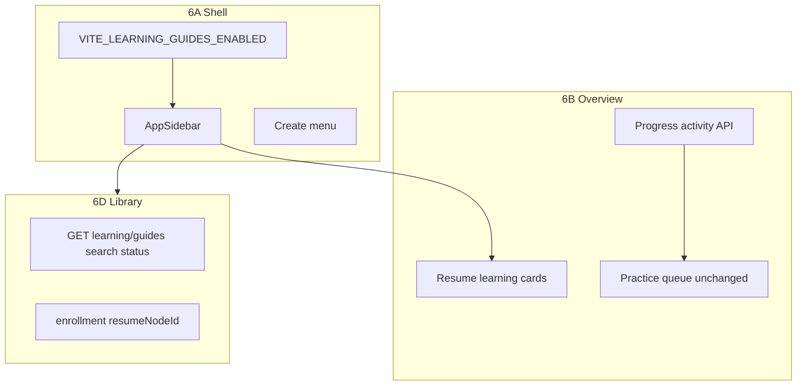

# Phase 6 — Product-wide integration and polish (slice plan)

**Branch:** `feature/learning-guides` (continued)  
**Prerequisite:** Phase 5 R1 complete ([LEARNING_5E_RESULTS.md](./LEARNING_5E_RESULTS.md), roadmap Phase 5 exit).  
**Objective (roadmap):** Make learning guides feel native to Practice without breaking existing coding workflows.

## Slice exit criteria

| Slice | Delivered | Signoff |
|-------|-----------|---------|
| **6.0** | Baseline inventory, activity/metrics contract, nav/IA decisions, Phase 5 gates still green | [LEARNING_6_0_RESULTS.md](./LEARNING_6_0_RESULTS.md) (complete) |
| **6A** | App shell + sidebar + Create menu; learning nav behind flag; a11y/focus preserved | [LEARNING_6A_RESULTS.md](./LEARNING_6A_RESULTS.md) (complete) |
| **6B** | Overview redesign: resume learning, practice queue, split domain loading | [LEARNING_6B_RESULTS.md](./LEARNING_6B_RESULTS.md) |
| **6C** | Documented dual metrics (no double counting); overview copy reflects semantics | [LEARNING_6C_RESULTS.md](./LEARNING_6C_RESULTS.md) |
| **6D** | Guide library search/filters/archive + resume shortcuts; keyboard nav | [LEARNING_6D_RESULTS.md](./LEARNING_6D_RESULTS.md) |
| **6E** | Landing, SEO/social meta, onboarding and empty-state copy (Learn / Practice / Track) | [LEARNING_6E_RESULTS.md](./LEARNING_6E_RESULTS.md) |
| **6F** | Responsive/a11y/content stress pass; dark mode **only if** 6.0 opts in | [LEARNING_6F_RESULTS.md](./LEARNING_6F_RESULTS.md) |
| **6G** | Requirements, API/deployment docs, phase signoff, `BASELINE_RUN` | [LEARNING_6_PHASE_SIGNOFF.md](./LEARNING_6_PHASE_SIGNOFF.md) |

**Phase exit criteria (roadmap):** Existing users keep substantive coding workflows; new learning-only users can onboard without creating problems; overview and navigation expose both domains independently.

**6A blocked until:** [LEARNING_6_0_RESULTS.md](./LEARNING_6_0_RESULTS.md).

---

## Design authority (read before 6.0)

| Doc | Use |
|-----|-----|
| [PRODUCT_INTEGRATION_DESIGN.md](../../../solve-tracker-frontend/docs/learning/PRODUCT_INTEGRATION_DESIGN.md) | IA, Create menu, cross-feature states |
| [SHELL_DASHBOARD_DESIGN.md](../../../solve-tracker-frontend/docs/learning/SHELL_DASHBOARD_DESIGN.md) | Sidebar order, overview sections |
| [LEARNING_WORKSPACE_DESIGN.md](../../../solve-tracker-frontend/docs/learning/LEARNING_WORKSPACE_DESIGN.md) | Library, resume, outline |
| [LEARNING_BASELINE_AUDIT.md](./LEARNING_BASELINE_AUDIT.md) | A07, A09–A12 → slice mapping |
| [DOMAIN_ARCHITECTURE.md](./DOMAIN_ARCHITECTURE.md) | ProgressModule vs Learning; no merged canonical completion |

Frontend conventions: `FRONTEND_CONVENTIONS.md`, `API_CLIENT.md`, generated OpenAPI types.

---

## Out of scope (Phase 6 R1)

| Item | Where |
|------|--------|
| Global cross-domain search (all blocks/notes) | R2 / PORTABILITY design |
| Combined activity API merging solve + learning events | Phase 6 **documents** separation; new aggregate API deferred |
| Planner, flashcards, public Discover guides | Phase 8 / R2 |
| Feature-flag removal (learning always on) | Phase 7 beta decision |
| Playwright E2E suite expansion | Optional 6F stub only; full E2E Phase 7 |

---

## Architecture sketch

**Locked R1 presentation rule (6C):** `GET /progress/activity` and existing problem stats remain **coding-only**. Learning progress surfaces via guide list, tree `completed`, enrollment `resumeNodeId` — never folded into solve streak or weekly solve counts without a new explicit contract.

---

## 6.0 — Baseline

- Record flag state (`VITE_LEARNING_GUIDES_ENABLED`), routes live under `/app/learning/*`, current sidebar vs design delta.
- Confirm `listGuidesQuerySchema` already supports `search`, `status` ([learning-guides.schema.ts](../../src/modules/learning/schemas/learning-guides.schema.ts)) — no migration expected for 6D.
- **Decision log:** dark mode in 6F or waived; Create menu contents; overview section order for mixed vs learning-only vs coding-only.
- Gate: Phase 5 integration count and `pnpm check` both repos unchanged green.

---

## 6A — Shell and navigation

**Frontend (primary)**

- [`AppSidebar.tsx`](../../../solve-tracker-frontend/src/components/app/AppSidebar.tsx), [`nav-active.ts`](../../../solve-tracker-frontend/src/lib/app/nav-active.ts), [`AppShell.tsx`](../../../solve-tracker-frontend/src/components/app/AppShell.tsx).
- Implement design order: Overview → My guides (flag) → Library/Topics/Progress labels as approved → Discover → profile/settings.
- **Create menu:** guide, import, problem, topic — hide unimplemented entries; **retain** direct Add problem on library routes per design.
- Mobile drawer: focus trap, restore focus on close (existing `shell-drawer-a11y`).

**Backend**

- None required unless new settings endpoints chosen in 6.0 (default: none).

**Tests**

- Extend `AppShell.test.tsx`, nav-active unit tests; manual keyboard pass checklist in RESULTS.

---

## 6B — Overview dashboard

**Frontend**

- [`routes/app/index.tsx`](../../../solve-tracker-frontend/src/routes/app/index.tsx) and dashboard components.
- Add **Continue learning** (recent guides + resume via enrollment/tree APIs).
- Keep **practice queue**, platform/topic strips, activity chart — independent `LoadStatus` per domain (design: one failure must not block the other).
- New users: empty learning section with CTA to create/import guide, not blocking problem CTAs.

**Backend (optional thin)**

- If overview needs a single “recent guides” aggregate: prefer **existing** `GET /learning/guides` with sort by `updatedAt` (add query param in 6B only if list API lacks sort — verify in 6.0).

**Tests**

- Component or route tests with mocked APIs for split error/empty/ready states.

---

## 6C — Metrics and activity semantics

**Docs + copy (minimal code)**

- **`LEARNING_6_ACTIVITY_CONTRACT.md`** (or section in 6C RESULTS): what counts toward solve streak vs learning completion; no double counting rules for mixed users.
- Overview labels/tooltips reference contract; no new combined percentage widget in R1.

**Backend**

- No change to `ProgressModule` unless audit finds accidental learning rows in problem aggregates (should be none).

**Tests**

- Regression: existing `progress.service.spec.ts` unchanged; snapshot overview strings in one frontend test optional.

---

## 6D — Guide library UX

**Frontend**

- [`routes/app/learning/index.tsx`](../../../solve-tracker-frontend/src/routes/app/learning/index.tsx): wire `search`, `status` (`active` / `archived`), pagination; archive shortcut from row actions (lifecycle API already exists).
- Resume: open guide overview or last `resumeNodeId` study path when present.
- Keyboard: list roving tabindex or native links; filter controls labeled.

**Backend**

- Confirm repository honors `search` + `status` (integration assert if missing).

**Tests**

- Integration: list `search=` and `status=archived` if not already covered; frontend filter unit tests.

---

## 6E — Landing, onboarding, marketing copy

**Frontend**

- [`landing-copy.ts`](../../../solve-tracker-frontend/src/components/landing/landing-copy.ts), route meta/Title/Description, OG tags where applicable.
- Post-auth first visit: optional lightweight chooser or empty-state CTAs (reversible, no forced funnel).
- Help strings on learning library, study shell cross-links to problems where relevant.

**Backend**

- None (public routes unchanged auth-wise).

**Tests**

- Copy snapshot or a11y on landing; no functional API tests.

---

## 6F — Responsive, content stress, accessibility

**Verification matrix (documented, not necessarily automated)**

- Long code blocks, wide tables, 360/768/1440, 200% zoom, `prefers-reduced-motion`.
- Large guide trees (existing hierarchy limits); study/editor overflow.
- **Dark mode:** only if 6.0 selects “in scope” — then `theme.css` + SSR init per SHELL design; otherwise explicit waiver in 6F RESULTS.

**Optional**

- Cheap Playwright smoke: login → overview → learning library (deferred full suite to Phase 7).

---

## 6G — Documentation and signoff

- Update [practice-learning-roadmap.md](./practice-learning-roadmap.md) Phase 6 checkboxes per slice.
- [LEARNING_REQUIREMENTS.md](./LEARNING_REQUIREMENTS.md) acceptance rows for integration journeys.
- Deployment/env: document `VITE_LEARNING_GUIDES_ENABLED` for staging/production.
- **`LEARNING_6_PHASE_SIGNOFF.md`**: cumulative gates, screenshots checklist, known deferrals.
- [BASELINE_RUN.md](./BASELINE_RUN.md): test counts, manual UX signoff note.

---

## Suggested execution order

1. **6.0** — decisions + inventory  
2. **6A** — navigation (unblocks discoverability of learning)  
3. **6C** — contract early (informs 6B copy)  
4. **6B** — overview  
5. **6D** — library polish  
6. **6E** — external-facing copy  
7. **6F** — verification pass  
8. **6G** — signoff  

6C can run parallel with 6A if contract drafted in 6.0.

---

## Gates (per slice, cumulative)

| Gate | Command |
|------|---------|
| Build/test backend | `pnpm build`, `pnpm test --run` |
| Build/test frontend | `pnpm check` |
| Learning integration | `node scripts/test-learning-integration.mjs` |
| Problems regression | `node scripts/test-problems-integration.mjs` |
| Contract | `pnpm api:check` when API touched |
| Feature flag off | Smoke: coding-only nav unchanged with flag false |

---

## Roadmap mapping

| Roadmap bullet (Phase 6) | Slice |
|--------------------------|-------|
| Navigation and responsive shell | 6A |
| Overview resume + practice queue | 6B |
| Distinct metrics / streak semantics | 6C |
| Landing, SEO, onboarding, empty states | 6E |
| Guide search, filters, archive, resume | 6D |
| Long-form content, responsive, a11y, dark mode | 6F |
| Requirements, API docs, deployment | 6G |

---

## Risks

| Risk | Mitigation |
|------|------------|
| Dashboard load cascade failures | Independent fetch + error UI per domain (6B) |
| Flag off vs on nav drift | Test both in 6A gates |
| Users infer combined “productivity score” | 6C contract + no merged widget |
| Dark mode half-done | Default **out** unless 6.0 commits with 6F scope |
| Guide list search performance | Use existing DB indexes on owner + title; paginate |

**After Phase 6:** Phase 7 hardening (security, perf, beta flag), not more learning feature depth.